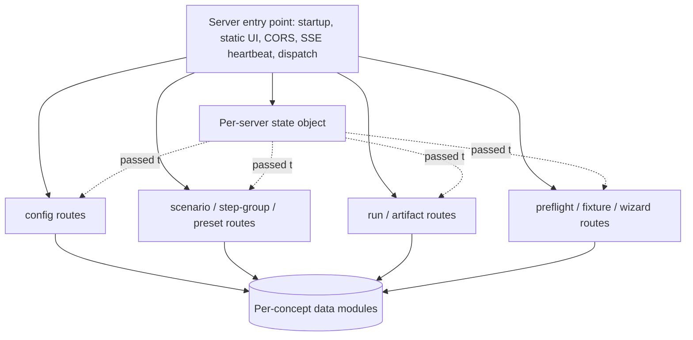
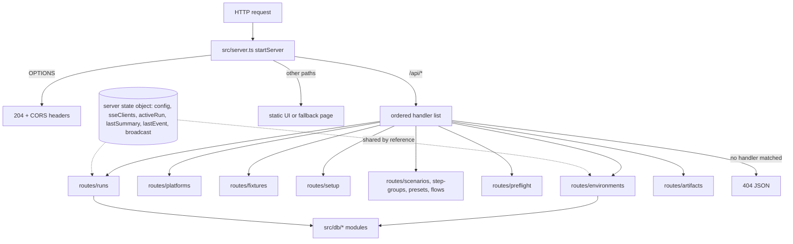

# Backend Module Split - Plan

## Goal Capsule

- **Objective:** An AI coding agent working on one backend resource (environments, platforms, fixtures, scenarios, step groups, presets, runs) loads only the code for that resource, so a single-area task stops paying for the whole data layer or the whole HTTP server. This plan covers the backend only; the UI components are not active scope.
- **Means:** A move-only split of `src/db.ts` into `src/db/` and of the routes in `src/server.ts` into `src/server/routes/`, plus a size convention and a warn-only size check (KTD1, KTD3, KTD5).
- **Product authority:** The repository owner (frankmungnodev) confirmed scope, the regrowth guard, and the move-only rule. On product behavior the Product Contract wins; on mechanism the Planning Contract's KTDs win.
- **Open blockers:** None.
- **Stop conditions:** Stop and report if an existing test needs any edit other than an import path to pass, because that means behavior changed (R7, R8). Also stop if a split module cannot get under the ~500-line budget without changing logic.
- **Execution profile:** One feature branch from `development` and one PR into `development`, with a commit per implementation unit. `ce-work` executes. The user reviews and merges.

---

## Product Contract

### Summary

Split the backend data layer and the HTTP routes into one file per domain concept, with no change in behavior. The server keeps a small entry point that owns startup and shared state and hands each request to that resource's route module. A documented ~500-line file budget and a warn-only check in `pnpm run check` keep new and existing files near that size.

### Problem Frame

Two backend files hold most of the server-side code. `src/db.ts` is 1618 lines (about 12k tokens): shared types, the SQLite schema, path resolution, and CRUD for every table in one file. `src/server.ts` is 1491 lines (about 15k tokens), and about 1350 of those are one `startServer` function that runs every `/api/*` route through a single `if (pathname === …)` chain.

An agent asked to change one scenario query or one presets endpoint opens these files to orient itself and usually reads all of them. Most of what it reads is unrelated to the task. That raises token cost per task, pushes useful context out of the window, and puts unrelated code within reach of each edit.

Line width is not the issue: only about 100 lines across the four largest files exceed 120 characters. The cost comes from file length and from very long single functions.

### Key Decisions

- **Backend first; UI monoliths later.** The backend has clean seams and test coverage (`test/db.test.ts`, `test/server.test.ts`, `test/authoring.test.ts`), so it is the low-risk first step. The UI files cost more tokens but have no tests. (session-settled: user-approved — chosen over UI decomposition first, a size-rule sweep of the worst files, or a convention with no refactor: lowest regression risk with the clearest seams.) Governs R1, R4.
- **Move only.** Code moves; behavior, endpoints, payloads, and schema do not change. A route table or router library is deferred. (session-settled: user-approved — chosen over restructuring dispatch during the split: keeps the diff reviewable and the existing tests a valid safety net.) Governs R7, R8.
- **Direct imports, no barrel.** Each importer names the specific module it uses, so an agent can tell from the import line which file to open without a second hop through an index file. (session-settled: user-approved — chosen over keeping `src/db.ts` as a re-export barrel: zero import churn, but every lookup goes through an extra file.) Governs R9.
- **Convention plus a soft check.** The size rule is written into the agent instructions and checked by a script that warns but never fails. (session-settled: user-approved — chosen over convention only, a hard CI gate, or no guard: a hard gate would fail today on the untouched UI files.) Governs R10, R11.
- **~500-line budget.** Large enough that `src/runner.ts` (450) and `src/drivers/web.ts` (414) need no change. (session-settled: user-approved — proposed as the default budget and confirmed at synthesis.) Governs R2, R10, R11.

### Requirements

**Data layer**

- R1. The contents of `src/db.ts` move into one module per domain concept (environments, platforms with their per-environment overrides, fixtures, scenarios with their steps, step groups, step presets, runs with their step runs), plus shared modules for row types, schema and connection setup, and database path resolution.
- R2. Every module produced by the split stays under the ~500-line budget.
- R3. Opening the database and creating tables stays in exactly one place, so schema creation order and the `CREATE TABLE IF NOT EXISTS` set are unchanged.

**HTTP routes**

- R4. Each resource's `/api/*` handlers move out of `startServer` into a route module for that resource. The server entry point keeps startup, initial config loading from the database, static UI serving, CORS handling, the SSE heartbeat, and dispatch to the route modules.
- R5. The per-server state that `startServer` currently closes over (current config, SSE clients, active run, last summary, last event, the `broadcast` function) is passed to route modules as one explicit object, created per `startServer` call.
- R6. No route module holds mutable module-level state, so two servers started in the same process (as the tests do) stay isolated.

**Behavior preservation**

- R7. Every endpoint keeps its path, method, request shape, response shape, and status codes. The SQLite schema and the exports of `src/index.ts` do not change.
- R8. `test/db.test.ts`, `test/server.test.ts`, `test/authoring.test.ts`, `test/config.test.ts`, and `test/wizard.test.ts` pass with no edits other than import paths.

**Imports**

- R9. Every importer of the old `src/db.ts` (in `src/` and `test/`) imports from the specific new module, and no re-export barrel replaces `src/db.ts`.

**Regrowth guard**

- R10. `AGENTS.md` (which `CLAUDE.md` links to) gains a short rule: one concept per file, with a ~500-line budget for source files.
- R11. `pnpm run check` runs a size script that lists every source file over the budget as a warning and exits successfully regardless of what it finds.

**Documentation**

- R12. References to `src/db.ts` and `src/server.ts` in `docs/domain/` are updated to the new module paths in the same change.



The diagram shows the shape required by R4 and R5. The route groupings in it are illustrative; the exact boundaries are a planning question.

### Success Criteria

- No file under `src/` exceeds the ~500-line budget after the split. The size script reports warnings only for UI files under `ui/src/`, which are deferred.
- A task touching one resource, such as "add a field to step presets", can be done by opening that resource's data module and route module, without reading the rest of the backend.

### Scope Boundaries

- Decomposing `ui/src/components/ScenarioBuilder.tsx`, `ConfigView.tsx`, `RunnerView.tsx`, and `PlatformModal.tsx` is deferred to its own brainstorm.
- Replacing the `if` chain dispatch with a route table or router library is deferred (per the move-only decision).
- Splitting `test/db.test.ts` (639 lines) is deferred.
- `src/runner.ts`, `src/drivers/*`, and the other backend files already under budget are not touched.
- Reformatting long lines or adding a line-width rule is out of scope; line width is not the cost driver.

<!-- ce-section: work-relationships -->
### How This Work Fits Together

This plan covers the backend data-layer and route split. The breakdown below is the current understanding, not a committed roadmap.

- UI component decomposition (`ScenarioBuilder`, `ConfigView`, `RunnerView`, `PlatformModal`)
  - Can proceed independently of this plan.
  - Shares the ~500-line budget and the size check introduced by R10 and R11, which will flag these files as warnings until that work lands.
  - Still to decide: how to reduce regression risk without UI tests.

### Outstanding Questions

**Deferred to Implementation**

- Exact names of the per-module route handler functions and the server state type.
- Whether static UI serving and the fallback page move out of `src/server.ts` into their own module. Move them only if the entry file would otherwise exceed the budget.

### Sources / Research

- `src/db.ts` — types at lines 6–177, schema in `openDatabase` (`CREATE TABLE` statements from line 263), CRUD grouped by table from line 506.
- `src/server.ts` — `startServer` from line 143. Its closure state and the SSE heartbeat are set up at lines 150–201, and the route chain runs from line 214 to about line 1374.
- `src/index.ts` — the only public export from these files is `startServer`.
- `scripts/check-boundary.mjs` — the existing check script wired into `pnpm run check`, and the model for the size script.

Product Contract preservation: Product Contract unchanged. The planning-deferred Outstanding Questions are answered by KTD1 to KTD6 and replaced by implementation-deferred items.

---

## Planning Contract

### Key Technical Decisions

- KTD1. **`src/db.ts` becomes the `src/db/` directory, one module per table group.** The modules are paths, connection (with schema), environments, platforms, env-platforms, fixtures, scenarios, step-groups, step-presets, and runs. Platforms and env-platforms are separate because together they would be about 450 lines, close to the budget, and they change for different reasons. `platformsToTargetsAndServices` lives with platforms, its input type. Governs R1, R2, R3.
- KTD2. **Each record type lives in its concept's module, not in a shared types file.** An agent working on runs reads only the run types. The step types (`Assert`, `StepAction`, `Step`) stay in the scenarios module along with `STEP_COMMON_KEYS` and the step row mapper, and step-groups and step-presets import them from there. (session-settled: user-approved — chosen over one shared `types.ts`: a shared file would put every type in front of every task.) Governs R1.
- KTD3. **`src/server.ts` stays the entry point at the same path, and routes move to `src/server/routes/`.** `src/index.ts`, `src/cli.ts`, and the `startServer` imports in tests stay valid. Response helpers (`sendJson`, `sendText`, `readBody`, `CORS_HEADERS`, `MIME_TYPES`) move to `src/server/http.ts`. Governs R4.
- KTD4. **Per-server state is one mutable object created inside `startServer` and passed by reference.** It holds `config`, `sseClients`, `activeRun`, `lastSummary`, `lastEvent`, and `broadcast`. Route modules read and assign its properties directly and never copy them into locals, because seven routes replace `config` after a reload and the run route clears `activeRun` from a background task. The state module is named `state.ts`, not `context.ts`, because `src/context.ts` already exists for scenario variable substitution. (session-settled: user-approved — the stale-reference risk was named and accepted at synthesis.) Governs R5, R6.
- KTD5. **Dispatch is an ordered list of route handlers.** Each handler gets the state, request, response, and URL, and returns whether it handled the request. The entry point tries them in turn and keeps the existing 404 fallback and 500 catch. Each module keeps its routes' `if` checks verbatim and in their original relative order. No route condition in one module can match a path owned by another module, so the order of modules does not affect which handler runs. Governs R4, R7.
- KTD6. **The size check is `scripts/check-size.mjs`, scanning `src/` and `ui/src/`.** It is modeled on `scripts/check-boundary.mjs` and added to the `check` script. It prints one warning line per file over 500 lines and always exits 0. `test/` is excluded because splitting `test/db.test.ts` is deferred. (session-settled: user-approved — chosen over scanning `test/` too: it would add one known warning with no planned fix.) Governs R11.

### High-Level Technical Design

Request flow after the split. This is directional and shows the module boundaries, not code.



Route-to-module mapping:

| Module | Routes |
|---|---|
| `routes/runs.ts` (events part) | `GET /api/events` |
| `routes/environments.ts` | `GET /api/config`, `POST /api/config/environment/active`, `POST` and `DELETE /api/config/environment` |
| `routes/platforms.ts` | `POST` and `DELETE /api/config/platform`, `GET /api/config/env-platforms`, `POST` and `DELETE /api/config/env-platform` |
| `routes/fixtures.ts` | `POST` and `DELETE /api/config/fixture`, `POST /api/fixtures/run` |
| `routes/setup.ts` | `POST /api/init`, `GET /api/wizard/detect`, `POST /api/wizard/apply` |
| `routes/scenarios.ts` | `GET`, `POST`, `DELETE /api/scenarios` |
| `routes/step-groups.ts` | `GET`, `POST`, `DELETE /api/step-groups` |
| `routes/presets.ts` | `GET`, `POST`, `DELETE /api/presets` |
| `routes/flows.ts` | `GET`, `POST /api/flows` |
| `routes/preflight.ts` | `GET /api/preflight`, `POST /api/preflight/start-service` |
| `routes/runs.ts` | `POST /api/run`, `POST /api/run/stop`, `GET /api/run/status`, `GET /api/runs`, `GET /api/runs/:id`, `GET /api/step-runs`, `GET /api/steps/:id/runs` |
| `routes/artifacts.ts` | `GET /api/artifacts/*` |

`GET /api/events` lives in `routes/runs.ts` because it streams run events. It sits first in the original chain, but its exact path match overlaps no other route, so moving it next to the run routes does not change matching (KTD5).

### Output Structure

```text
src/
  db/
    paths.ts            project dir, db path, pointer file, checkDbStatus
    connection.ts       openDatabase (schema), withDb, safeJsonParse
    environments.ts
    platforms.ts        platforms + platformsToTargetsAndServices
    env-platforms.ts    per-environment overrides, getPlatformsForEnv
    fixtures.ts
    scenarios.ts        step types, scenario + step rows
    step-groups.ts
    step-presets.ts
    runs.ts             runs + step runs
  server.ts             startServer entry, static serving, listen
  server/
    http.ts             sendJson, sendText, readBody, CORS, MIME types
    state.ts            per-server state object + broadcast
    routes/             one module per resource (table above)
scripts/
  check-size.mjs
```

### Assumptions

- `node:sqlite` `DatabaseSync` handles are opened per call through `withDb`, so moving functions between modules does not change connection lifetime.
- `src/db.ts` imports `src/config.ts` for types only, so splitting it adds no runtime import cycle. Each new module keeps those imports type-only.

### Sequencing

U1 is independent and lands first so the warnings show progress. U2 and U3 can be done in either order. U4 depends on U2 (new db import paths) and U3 (state object). U5 is last.

---

## Implementation Units

### U1. Size check script and convention

**Goal:** Add the warn-only size check and the written convention.

**Requirements:** R10, R11; KTD6.

**Dependencies:** None.

**Files:**
- `scripts/check-size.mjs` (new)
- `package.json` (add `check:size` and include it in `check`)
- `AGENTS.md` (`CLAUDE.md` is a symlink to it)

**Approach:**
1. Mirror the file walk in `scripts/check-boundary.mjs`. Count lines in `.ts`, `.tsx`, `.js`, and `.mjs` files under `src/` and `ui/src/`.
2. Print one line per file over 500 lines with its line count, then exit 0.
3. Add a short "Code Organization" section to `AGENTS.md`: one concept per file, a ~500-line budget, warnings from `pnpm run check:size`, and split by domain concept rather than by layer.

**Patterns to follow:** `scripts/check-boundary.mjs`.

**Test scenarios:**
- Test expectation: none -- warn-only tooling with no runtime behavior. Check it by running it.
- On the current tree, a manual run lists `src/db.ts`, `src/server.ts`, and the four UI monoliths, and exits 0.
- Manual boundary check: a file of exactly 500 lines is not listed, and a file of 501 lines is.

**Verification:** `pnpm run check` runs the size script, prints warnings, and still passes.

### U2. Split the data layer into `src/db/`

**Goal:** Replace `src/db.ts` with the per-concept modules in KTD1, and point every importer at them directly.

**Requirements:** R1, R2, R3, R7, R8, R9; KTD1, KTD2.

**Dependencies:** None.

**Files:**
- `src/db/paths.ts`, `src/db/connection.ts`, `src/db/environments.ts`, `src/db/platforms.ts`, `src/db/env-platforms.ts`, `src/db/fixtures.ts`, `src/db/scenarios.ts`, `src/db/step-groups.ts`, `src/db/step-presets.ts`, `src/db/runs.ts` (new)
- `src/db.ts` (delete)
- Importers: `src/server.ts`, `src/config.ts`, `src/scenario.ts`, `src/runner.ts`, `src/init.ts`, `src/wizard.ts`
- Tests (import paths only): `test/db.test.ts`, `test/authoring.test.ts`, `test/config.test.ts`, `test/wizard.test.ts`

**Approach:**
1. Move code verbatim, block by block. Each row type and mapper goes with the CRUD functions that use it (KTD2).
2. Keep `openDatabase`'s `CREATE TABLE` block intact in `connection.ts` (R3).
3. Leave the aliased imports in `src/server.ts` (`getEnvironments as getDbEnvironments`, and so on) as they are, only re-pointed at the new paths. U4 moves those call sites.
4. Delete `src/db.ts` and don't add a barrel (R9).

**Execution note:** Pure move. If an existing test fails, check the move rather than changing the test.

**Patterns to follow:** The existing `.ts` extension imports (`./db.ts`), so new imports use the `./db/<module>.ts` form.

**Test scenarios:**
- Test expectation: no new tests. This is a code move. The existing `test/db.test.ts` suite covers every CRUD function and must pass unchanged apart from imports.

**Verification:** `src/db.ts` no longer exists. Every `src/db/*` file is under 500 lines. Typecheck and the full test suite pass.

### U3. Extract HTTP helpers and the server state object

**Goal:** Turn the variables `startServer` closes over into one state object, and move the response helpers to a shared module, while all routes still live in `src/server.ts`.

**Requirements:** R5, R6, R7; KTD3, KTD4.

**Dependencies:** None.

**Files:**
- `src/server/http.ts` (new)
- `src/server/state.ts` (new)
- `src/server.ts`
- `test/server.test.ts` (new isolation test)

**Approach:**
1. Move `CORS_HEADERS`, `MIME_TYPES`, `sendJson`, `sendText`, and `readBody` to `src/server/http.ts`.
2. Move the `ActiveRun` type and add a state factory in `src/server/state.ts` that builds the object and its `broadcast` function.
3. In `startServer`, replace every read and assignment of `currentConfig`, `activeRun`, `lastSummary`, and `lastEvent` with property access on the state object. That includes the reassignments after config reloads and the background run task that clears `activeRun`. The SSE heartbeat and the close handler use `state.sseClients`.

**Execution note:** Land this before U4. It isolates the one non-mechanical change so a test failure points at it rather than at the route move.

**Test scenarios:**
- Two servers started in one process with different config dirs each return their own environments from `GET /api/config` (R6).
- After `POST /api/config/environment/active` on one server, `GET /api/config` on that server reflects the new active environment, and the other server is unchanged.
- The existing run lifecycle tests in `test/server.test.ts` still pass: start a run, see its status as active, then idle with a summary once it finishes.

**Verification:** Every existing server and authoring test passes, and the new isolation test passes.

### U4. Move route groups into `src/server/routes/`

**Goal:** Move each resource's handlers out of `startServer` into the route modules in the HTD table, and dispatch through the ordered handler list.

**Requirements:** R4, R5, R7, R8; KTD3, KTD4, KTD5.

**Dependencies:** U2, U3.

**Files:**
- `src/server/routes/environments.ts`, `platforms.ts`, `fixtures.ts`, `setup.ts`, `scenarios.ts`, `step-groups.ts`, `presets.ts`, `flows.ts`, `preflight.ts`, `runs.ts`, `artifacts.ts` (new)
- `src/server.ts`

**Approach:**
1. Move one resource group at a time and run the tests after each move. Keep each `if` condition and handler body verbatim.
2. Each handler imports the `src/db/*` functions it uses under their real names, which drops the `getDb…` aliases.
3. The entry point keeps OPTIONS handling, the `/api/` prefix check, the try/catch that returns 500, the 404 fallback, static serving, the fallback page, and `listen`.
4. Within each module, keep the routes in their original relative order (KTD5).

**Patterns to follow:** The original route chain in `src/server.ts`.

**Test scenarios:**
- Test expectation: no new tests beyond U3. `test/server.test.ts` and `test/authoring.test.ts` exercise the routes end to end and must pass unchanged.
- An unknown `/api/` path still returns 404 after dispatch moves. The existing check in `test/server.test.ts` (`GET /api/nonexistent`) covers this.

**Verification:** `src/server.ts` and every route module are under 500 lines, and the full suite passes.

### U5. Update domain docs

**Goal:** Point `docs/domain/` at the new module paths.

**Requirements:** R12.

**Dependencies:** U2, U4.

**Files:** `docs/domain/README.md`, `docs/domain/environments.md`, `docs/domain/platforms.md`, `docs/domain/fixtures.md`, `docs/domain/scenarios.md`, `docs/domain/runs.md`

**Approach:** Replace each `src/db.ts` reference with the specific `src/db/<module>.ts` file for that entity, and each `src/server.ts` route reference with its route module. No semantic doc changes.

**Test scenarios:**
- Test expectation: none -- documentation only.

**Verification:** `docs/domain/` contains no references to `src/db.ts`.

---

## Verification Contract

| Gate | Command | Applies to |
|---|---|---|
| Lint and format | `pnpm exec biome check --write`, then `pnpm run lint` | Every unit |
| Typecheck, boundary, tests | `pnpm run check` | Every unit |
| Size warnings | `pnpm run check:size` | U1 onward: after U4, no file under `src/` is listed |
| Stale references | Search `src/`, `test/`, and `docs/domain/` for `db.ts"` and `src/db.ts` | U2, U5 |

Behavioral proof is the existing suite passing with only import-path edits (R8), plus the U3 isolation test.

---

## Definition of Done

- All requirements R1 to R12 hold.
- `src/db.ts` is gone. Every file under `src/` is under 500 lines, and `pnpm run check:size` warns only on `ui/src/` files.
- `pnpm run check` and `pnpm run lint` pass with no new warnings.
- The diff to existing test files is limited to import lines, plus the new U3 isolation test.
- `AGENTS.md` contains the size convention, and `docs/domain/` references the new paths.
- No leftover scaffolding: no temporary re-export shims, commented-out old code, or unused helpers from intermediate steps.
