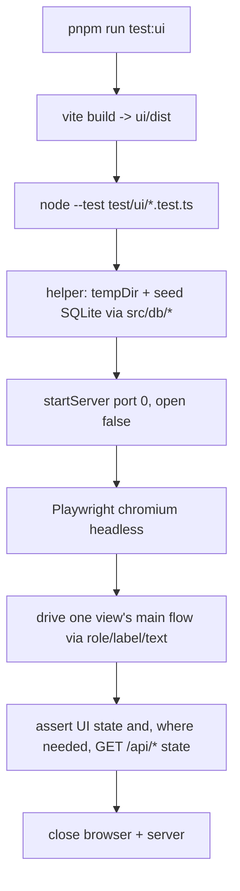

# UI Component Split - Plan

## Goal Capsule

- **Objective:** An AI coding agent working on one part of the UI (a config tab, a platform form, the step inspector, the run log) loads only that part's code, and a regression in a main UI flow fails a test instead of shipping unnoticed.
- **Means:** A Playwright smoke suite over each view's main flows, then a split of `ScenarioBuilder.tsx`, `ConfigView.tsx`, `RunnerView.tsx`, and `PlatformModal.tsx` into per-view folders of child components and custom hooks, with no behavior or styling change.
- **Product authority:** The repository owner (frankmungnodev) confirmed the safety net, the split depth, where the suite runs, and the scope in this brainstorm. This continues the backend split in `docs/plans/2026-10-02-1204-refactor-backend-module-split-plan.md`.
- **Open blockers:** None.
- **Stop conditions:** Stop and report if a smoke test cannot pass on the unsplit UI without changing visible behavior (R4), or if keeping a split file under budget would need a behavior or styling change (R7).
- **Execution profile:** One feature branch cut from the current `feat/web-gui` HEAD, with a commit per implementation unit. `ce-work` executes, and the user reviews and merges.

---

## Product Contract

### Summary

First add a browser smoke suite, `pnpm run test:ui`, that drives each large view's main flows against a real server on a temporary project. Then split the four large UI components into per-view folders of child components and custom hooks so every file fits the ~500-line budget. The suite must pass before and after each component's split, and it stays as permanent UI coverage.

### Problem Frame

Four files hold most of the frontend: `ui/src/components/ScenarioBuilder.tsx` (2327 lines, about 26k tokens), `ConfigView.tsx` (1479), `RunnerView.tsx` (976), and `PlatformModal.tsx` (970). They are the only files the size check from the backend split still warns about. An agent changing one config tab or one platform form reads the whole file to find its way.

These files are harder to split than the backend was. Most of each file is JSX that reads and writes the parent's state: `ScenarioBuilder` has 18 `useState` calls and `PlatformModal` has 22. Moving markup out means designing props and hooks, not cutting and pasting. No test covers any UI flow today. Typecheck catches broken prop wiring, but a lost `onChange`, a wrong initial value, or a modal that no longer closes would pass every check that exists.

### Key Decisions

- **A Playwright smoke suite comes before any split.** The repo already depends on Playwright, and the suite stays as permanent coverage rather than a temporary harness. (session-settled: user-approved — chosen over typecheck plus manual click-through, and over screenshot comparison, which catches layout drift but not broken handlers.) Governs R1, R2, R3, R4.
- **The suite runs as its own script, not inside `pnpm run check`.** That keeps the everyday check fast and free of browser installs. (session-settled: user-approved — chosen over running it in every check, and over deleting it after the refactor.) Governs R3, R5.
- **Split depth is child components plus custom hooks.** Related state and handlers move into hooks, and JSX sections move into child components. (session-settled: user-approved — chosen over extracting components only, which leaves parents with 18-22 `useState` calls near the budget, and over a full state redesign with reducers or a store, which carries the highest regression risk.) Governs R6, R7, R8.
- **Each view gets its own folder, and shared primitives stay where they are.** This mirrors the backend layout, so an agent finds a view's parent component, child components, and hooks together. (session-settled: user-approved — proposed at synthesis and confirmed.) Governs R9.
- **The scope is the four oversized files.** Views already under budget get no folder move and no smoke tests in this plan. (session-settled: user-approved — confirmed at synthesis.) Governs R1, R9.

### Requirements

**Smoke suite**

- R1. A browser test suite covers one main flow per large view:
  - **Scenario builder:** create, edit, and save a scenario; add a step from a driver and from a preset.
  - **Config:** switch the active environment; add and test-run a fixture.
  - **Platform modal:** add a platform, and edit one, through each of its three forms (web, mobile, API).
  - **Runner:** start a run and see its steps and logs update.
- R2. The suite runs against the built UI and a real server on a throwaway project directory, never the developer's own project or database.
- R3. `pnpm run test:ui` runs the suite, and `pnpm run check` does not.
- R4. The suite passes on the current, unsplit UI before any component is split.
- R5. `AGENTS.md` tells agents to run `pnpm run test:ui` after changing anything under `ui/src/`.

**Component split**

- R6. `ScenarioBuilder`, `ConfigView`, `RunnerView`, and `PlatformModal` are each split into a parent component, child components for distinct sections, and custom hooks for related state and handlers, with every resulting file under the ~500-line budget.
- R7. The split changes no behavior, styling, copy, URL tab state, or API call. New child components use the existing primitives exactly as `DESIGN.md` documents them.
- R8. The smoke suite passes after each component's split, not only at the end.

**Layout**

- R9. Each of the four views lives in its own folder under `ui/src/views/` (for example `ui/src/views/scenario-builder/`). Shared primitives (`Button`, `Modal`, `Select`, and the rest) stay in `ui/src/components/`. `PlatformModal` goes with the config view, since only `ConfigView` opens it.
- R10. After the split, `pnpm run check:size` warns about no file under `ui/src/`.

### Success Criteria

- `pnpm run check:size` reports no oversized files anywhere.
- A task such as "add a field to the API platform form" can be done by opening that form's component and its hook, without reading the other platform forms or the config view.
- Breaking a main flow on purpose, for example by removing a save handler's call, makes `pnpm run test:ui` fail.

### Scope Boundaries

- Views already under budget stay out of scope, including `ArtifactsView`, `PreflightView`, `EnvironmentModal`, `Header`, and `App.tsx`. They get no folder move and no smoke tests.
- Smoke tests cover the main flows only. Validation messages, error toasts, empty states, and keyboard behavior stay checked by eye.
- No reducers, global store, or data-fetching library. That is a possible follow-up once the suite exists.
- No visual or `DESIGN.md` changes, even where the split exposes inconsistencies. Note them for later rather than fixing them here.
- Running the suite in CI is deferred. It stays out of `pnpm run check` per R3.

<!-- ce-section: work-relationships -->
### How This Work Fits Together

This plan covers the UI half of reducing per-task context. The backend half has shipped (`docs/plans/2026-10-02-1204-refactor-backend-module-split-plan.md`). This breakdown is the current understanding, not a committed roadmap.

- Backend module split
  - Done. Introduced the ~500-line budget and `scripts/check-size.mjs`, which this plan's R10 relies on.
- Running the UI smoke suite in CI
  - Depends on this plan's suite.
  - Still to decide: whether CI installs Playwright browsers.
- State simplification with reducers or a store
  - Depends on this plan's suite as its safety net.
  - Can proceed independently of the folder layout.

### Outstanding Questions

**Deferred to Implementation**

- Exact child-component and hook boundaries inside each view, within the shapes KTD5 names.
- Which elements need a `data-testid` because no stable role, label, or text locator exists (KTD3).

### Sources / Research

- `ui/src/components/ScenarioBuilder.tsx`: logic and state in lines 1-750 and JSX from line 751. Step-type option tables (`WEB_ACTION_OPTIONS`, `DRIVER_OPTIONS`) sit at the top of the file.
- `ui/src/components/ConfigView.tsx`: four URL tabs (`VALID_SECTIONS`: environments, platforms, fixtures, database), with JSX from line 503. It is the only file that imports `PlatformModal`.
- `ui/src/components/PlatformModal.tsx`: 22 `useState` calls, one set per platform type (web, mobile, API), with JSX from line 488.
- `ui/src/components/RunnerView.tsx`: run options, the execution tree, and the log panel, with JSX from line 314.
- `ui/src/App.tsx`: imports all four views from `ui/src/components/`.
- `package.json`: `playwright` is already a dependency, and the UI builds with `pnpm run build:ui`.
- `DESIGN.md`: the component primitives and tokens new child components must use.

Product Contract preservation: Product Contract unchanged. The planning-deferred Outstanding Questions are answered by KTD1, KTD2, KTD4, and KTD6.

---

## Planning Contract

### Key Technical Decisions

- KTD1. **The suite uses Playwright as a library under `node --test`, in `test/ui/`.** This matches `test/web-driver.test.ts`, adds no test-runner dependency, and keeps `pnpm test` unchanged, because its glob is `test/*.test.ts` and does not reach `test/ui/`. `pnpm run test:ui` runs `pnpm run build:ui` and then `node --import tsx --test "test/ui/*.test.ts"`. Governs R1, R3. (session-settled: user-approved — chosen over the Playwright test runner: one test runner across the repo.)
- KTD2. **Each test file starts its own server on port 0 over a seeded temporary project.** A shared helper creates the project directory with `tempDir`, writes environments, a platform, a fixture, and scenarios directly through the `src/db/*` functions, starts `startServer` with `open: false`, launches headless Chromium, and closes everything in `after`. The server serves the built `ui/dist`, so the UI calls the same origin's `/api`. Governs R2. (session-settled: user-approved — chosen over clicking through `/api/init` setup in each test.)
- KTD3. **Tests locate elements by role, label, and visible text first.** Where none of those is stable, U2 adds a `data-testid` attribute to the unsplit component. That is the only markup change this plan allows, and it changes no appearance or behavior. Splits must keep every `data-testid`. Governs R1, R7. (session-settled: user-approved — chosen over adding test IDs throughout: accessible locators keep the markup unchanged where possible.)
- KTD4. **The runner flow runs a shell-only scenario.** The seeded scenario uses `target: "shell"` steps (`echo`), so a run needs no device, browser target, or service. `test/authoring.test.ts` already proves this path. Governs R1.
- KTD5. **Each view becomes a folder with one parent, child components per section, and hooks per state cluster.** The parent keeps layout and wiring. Each JSX section with its own heading comment becomes a child component that takes the values and callbacks it uses as props. Each group of `useState` calls and handlers that change together becomes a `use<Name>` hook in the same folder. Static option tables, such as `WEB_ACTION_OPTIONS` and `DRIVER_OPTIONS`, move to a constants module in that folder. Folders use kebab-case, and components use the existing PascalCase `.tsx` file names. Governs R6, R9.
- KTD6. **Split order is smallest first: `PlatformModal`, `RunnerView`, `ConfigView`, `ScenarioBuilder`.** The prop-and-hook pattern is proven on the smaller files first. `ConfigView` follows `PlatformModal` because it imports it. Governs R8. (session-settled: user-approved — chosen over doing `ScenarioBuilder` first for the earliest token win.)

### High-Level Technical Design

Smoke test lifecycle (directional):



Target layout after all splits (directional, the per-unit file lists are authoritative):

```text
ui/src/
  components/            shared primitives only (Button, Modal, Select, ...)
  views/
    config/              ConfigView parent, EnvironmentsTab, PlatformsTab, FixturesTab,
                         DatabaseTab, fixture modals, hooks (useEnvironmentEditor, useFixtures, ...)
      platform-modal/    PlatformModal parent, WebPlatformForm, MobilePlatformForm,
                         ApiPlatformForm, usePlatformForm
    runner/              RunnerView parent, ScenarioExplorer, RunOptions, ResultsStage,
                         StepTree, LogPanel, useRunEvents
    scenario-builder/    ScenarioBuilder parent, ScenarioExplorer, StepList, StepInspector,
                         per-driver step editors, AddStepModal, SavePresetModal,
                         ScenarioSettingsModal, constants, hooks
test/ui/
  helpers.ts             seed + server + browser lifecycle
  scenario-builder.test.ts, config.test.ts, platform-modal.test.ts, runner.test.ts
```

### Assumptions

- The Chromium build Playwright needs is installed on development machines. It is present under the Playwright cache today, and `test/web-driver.test.ts` already relies on it.
- `ScenarioBuilder`'s inspector body (about 900 lines, lines 1034-1947) splits cleanly by step driver (web, mobile, HTTP, shell). That is the main uncertainty in reaching R6 for this file.

### Sequencing

U1 then U2 must land before any split (R4). U3, U4, U5, and U6 follow KTD6's order, each gated on `pnpm run test:ui` passing (R8). U7 runs last.

---

## Implementation Units

### U1. Smoke-test harness and script

**Goal:** Give tests a one-call way to start a seeded server and a browser, and add `pnpm run test:ui`.

**Requirements:** R2, R3, R5; KTD1, KTD2.

**Dependencies:** None.

**Files:**
- `test/ui/helpers.ts` (new)
- `package.json` (add `test:ui`)
- `AGENTS.md` (one line in "Code Organization" or "Linting & Quality Checks": run `pnpm run test:ui` after changing `ui/src/`)

**Approach:**
1. The helper builds a temp project like `mockProject` in `test/server.test.ts`, then seeds it through `openDatabase` and the `src/db/*` save functions: two environments, one web platform, one fixture whose command is `echo`, and one shell-only scenario (KTD4).
2. It returns the server URL, a Playwright `page`, and a cleanup function. It fails fast with a clear message if `ui/dist/index.html` is missing.
3. Keep the helper free of view-specific logic.

**Patterns to follow:** `test/server.test.ts` (`mockProject`), `test/authoring.test.ts` (DB seeding and shell runs), `test/web-driver.test.ts` (Playwright as a library).

**Test scenarios:**
- A trivial `test/ui/app.test.ts` opens `/` and sees the app header, which proves the harness.

**Verification:** `pnpm run test:ui` builds the UI and passes the trivial test. `pnpm test` still runs only `test/*.test.ts`.

### U2. Main-flow smoke tests on the unsplit UI

**Goal:** Cover R1's flows against the current components so they protect every later split.

**Requirements:** R1, R4; KTD3, KTD4.

**Dependencies:** U1.

**Files:**
- `test/ui/scenario-builder.test.ts`, `test/ui/config.test.ts`, `test/ui/platform-modal.test.ts`, `test/ui/runner.test.ts` (new)
- `ui/src/components/ScenarioBuilder.tsx`, `ConfigView.tsx`, `RunnerView.tsx`, `PlatformModal.tsx` (only `data-testid` additions, if any, per KTD3)

**Approach:** Each test drives the UI and then confirms persisted state through the UI, or through a `GET /api/*` call when the UI does not show it.

**Test scenarios:**
- Scenario builder: create a scenario, rename it, save it, reload the page, and the name persists.
- Scenario builder: add a step through the Add Step modal's Drivers tab and another through its Presets tab, and both appear in the step list in order.
- Config: switch the active environment from the environments tab, and `GET /api/config` reports the new `activeEnvironment`.
- Config: add a fixture, test-run it, and the output modal shows the `echo` text.
- Platform modal: add a web, a mobile, and an API platform, and each appears in the platforms tab. Edit one field of an existing platform, and the change persists after reload.
- Runner: select the seeded shell scenario, start a run, and the step list reaches a passed state while the log panel shows the `echo` output.
- Breaking a flow on purpose fails the matching test. Check this once by hand, for example by commenting out a save call, and record the result in the unit's verification notes rather than adding a test.

**Verification:** All four files pass on the unsplit UI (R4), and `git diff ui/src` for this unit shows only `data-testid` attributes.

### U3. Split `PlatformModal`

**Goal:** Move `PlatformModal` into `ui/src/views/config/platform-modal/` as a parent plus per-platform forms and a form hook.

**Requirements:** R6, R7, R8, R9; KTD5, KTD6.

**Dependencies:** U2.

**Files:** `ui/src/views/config/platform-modal/*` (new); `ui/src/components/PlatformModal.tsx` (delete); `ui/src/components/ConfigView.tsx` (import path).

**Approach:**
1. Use the section comments as seams: workspace banner, platform selection, web form, Android form, and API form.
2. The web, mobile, and API field groups become `usePlatformForm` state (or one hook per platform type), and the forms take values and setters as props.
3. Submit and reset handlers stay in the parent or the hook.

**Test scenarios:**
- Test expectation: no new tests. `test/ui/platform-modal.test.ts` and `test/ui/config.test.ts` must pass unchanged.

**Verification:** Every new file is under 500 lines. `pnpm run test:ui`, `pnpm run check`, and `pnpm run lint` pass.

### U4. Split `RunnerView`

**Goal:** Move `RunnerView` into `ui/src/views/runner/`.

**Requirements:** R6, R7, R8, R9; KTD5, KTD6.

**Dependencies:** U2.

**Files:** `ui/src/views/runner/*` (new); `ui/src/components/RunnerView.tsx` (delete); `ui/src/App.tsx` (import path).

**Approach:**
1. Seams: scenario explorer and filter, run options and launch, status and progress bar, view-mode toolbar, idle state, step tree pane, and log pane.
2. The SSE subscription and execution-tree state become a `useRunEvents` hook.
3. Run options state becomes a `useRunOptions` hook.

**Test scenarios:**
- Test expectation: no new tests. `test/ui/runner.test.ts` must pass unchanged.

**Verification:** As U3.

### U5. Split `ConfigView`

**Goal:** Move `ConfigView` into `ui/src/views/config/`, with one child component per tab.

**Requirements:** R6, R7, R8, R9; KTD5, KTD6.

**Dependencies:** U3.

**Files:** `ui/src/views/config/*` (new); `ui/src/components/ConfigView.tsx` (delete); `ui/src/App.tsx` (import path).

**Approach:**
1. Tabs become `EnvironmentsTab`, `PlatformsTab`, `FixturesTab`, and `DatabaseTab`. The fixture add/edit modal and the run-output modal become their own components.
2. Environment profile editing, fixture state, and platform toggling become hooks.
3. URL tab state (`useUrlTab`) stays in the parent so URLs do not change (R7).

**Test scenarios:**
- Test expectation: no new tests. `test/ui/config.test.ts` and `test/ui/platform-modal.test.ts` must pass unchanged.

**Verification:** As U3.

### U6. Split `ScenarioBuilder`

**Goal:** Move `ScenarioBuilder` into `ui/src/views/scenario-builder/`.

**Requirements:** R6, R7, R8, R9; KTD5, KTD6.

**Dependencies:** U2, U5.

**Files:** `ui/src/views/scenario-builder/*` (new); `ui/src/components/ScenarioBuilder.tsx` (delete); `ui/src/App.tsx` (import path).

**Approach:**
1. The option tables (`WEB_ACTION_OPTIONS`, `MOBILE_ACTION_OPTIONS`, `HTTP_ACTION_OPTIONS`, `SHELL_ACTION_OPTIONS`, `DRIVER_OPTIONS`) move to `constants.ts`.
2. The three columns become `ScenarioExplorer`, `StepList`, and `StepInspector`.
3. The inspector body splits into one editor per step driver (see Assumptions), plus the JSON mode.
4. The three modals (Add Step, Save Preset, and Scenario Settings) become components.
5. Draft scenario, selection, save, and JSON-sync state become hooks such as `useScenarioDraft` and `useStepPresets`.

**Execution note:** Split the inspector body last, and run the scenario-builder smoke test after each driver editor moves out.

**Test scenarios:**
- Test expectation: no new tests. `test/ui/scenario-builder.test.ts` must pass unchanged.

**Verification:** As U3.

### U7. Close out

**Goal:** Confirm the budget holds everywhere, and update docs that name the old paths.

**Requirements:** R9, R10.

**Dependencies:** U3, U4, U5, U6.

**Files:** `DESIGN.md` and any `docs/` file that names `ui/src/components/<View>.tsx` for the four moved views.

**Approach:** Point references at `ui/src/views/...` without changing their meaning. `DESIGN.md`'s primitives section still points at `ui/src/components`, which stays correct.

**Test scenarios:**
- Test expectation: none -- documentation only.

**Verification:** `pnpm run check:size` prints its "passed" line. A search for the four old component paths in `docs/`, `DESIGN.md`, and `AGENTS.md` finds nothing.

---

## Verification Contract

| Gate | Command | Applies to |
|---|---|---|
| Lint and format | `pnpm exec biome check --write`, then `pnpm run lint` | Every unit |
| Typecheck, boundary, size, unit tests | `pnpm run check` | Every unit |
| UI smoke suite | `pnpm run test:ui` | U1 onward. Every split unit must pass it unchanged. |
| Size | `pnpm run check:size` | After U7, no warnings |
| Markup-only proof | `git diff` of `ui/src` in U2 shows only `data-testid` additions | U2 |

Behavioral proof for the splits is the U2 suite passing unchanged after each of U3 to U6 (R8).

---

## Definition of Done

- All requirements R1 to R10 hold.
- `pnpm run test:ui`, `pnpm run check`, and `pnpm run lint` pass. `pnpm run check:size` reports no oversized files.
- The four old component files are gone from `ui/src/components/`, and `App.tsx` imports from `ui/src/views/`.
- No smoke test was edited after U2 to make a split pass. If one needed to change, the change is explained in the unit's commit message as a selector fix, not a behavior change.
- No leftover scaffolding: no re-export shims at the old paths, commented-out JSX, or unused hooks.
