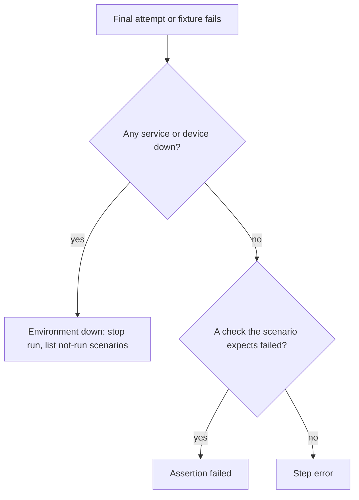
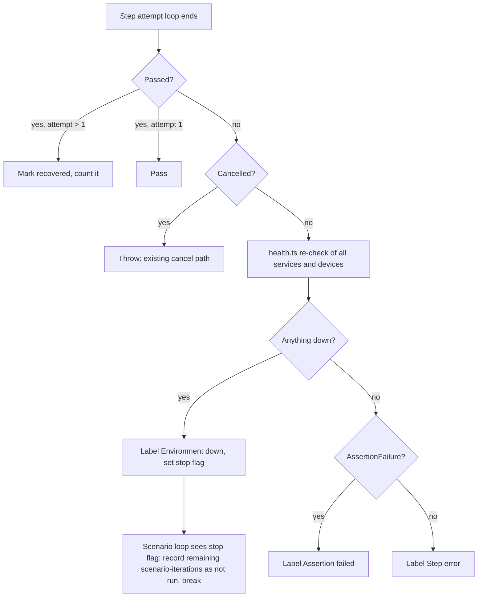

# Failure Labels and Recovered Steps - Plan

## Goal Capsule

- **Objective:** Someone reading an e2e run result can tell whether to look at the environment or at the product first, and can see when a green result needed retries to get there.
- **Means:** Re-check the run's services and devices after a final failed attempt, then label the failure, and record attempts per iteration so retry-rescued steps stay visible (KTD1, KTD3, KTD4).
- **Product authority:** The Product Contract below. Per-step history and flake statistics are not active scope.
- **Stop conditions:** Stop and ask if a Key Decision proves unworkable, for example if the environment-down stop cannot write `summary.json` and the `finish` event. Also stop and ask if a change would alter an existing exit code other than through `--strict`.
- **Execution profile:** One branch from `development`. Units land in order U1 to U6, and each unit leaves `pnpm run check` green.
- **Open blockers:** None.

---

## Product Contract

Product Contract preservation: changed R1 and R2 during planning, after the user answered two questions. R1 now covers setup fixtures. R2 now re-checks every service the run prepared and every device it picked, instead of only the failing scenario's own. AE6 was added, and the two Outstanding Questions were resolved in place. All other content is unchanged.

### Summary

Each failed step or setup fixture gets a label that says what happened: "Environment down", "Assertion failed" or "Step error". When the last retry fails, the runner re-checks the run's services and Android devices. If something is down, the run stops.

A step that passes only after a retry still passes, but is marked "recovered" and counted in the run summary. A `--strict` flag makes recovered steps fail the run.

### Problem Frame

A failed run today reports one error string per failure. A mixed run depends on started services, a browser and an Android device. When it goes red, the error string does not say whether the product broke or a service or the emulator went away, so someone has to work that out by hand. The health probe that could answer it already exists, but it runs only before the run starts.

Retries hide the opposite problem. A step that fails once and passes on retry makes the run plain green. Every attempt is already written to run history, and nothing reads the rows back.

The consumer project uses this suite as its integration check. A red result that is really infrastructure, or a green result that needed retries, makes that check harder to trust.

### Key Decisions

- **Label by what happened, not by who is to blame.** The tool knows whether a service is down, whether an assertion failed, or whether the step errored. It cannot know whether a missing button is a test bug or a product bug. Governs R1, R3, R4. (session-settled: user-approved — chosen over blame labels ENV / PRODUCT / TEST: "TEST" would be wrong whenever a step error is really a product bug)
- **Ship labels and the recovered marker now; defer history and statistics.** The tool has little real usage yet. Labels help from the first failure, while pass rates and duration statistics need many runs before they say anything. (session-settled: user-approved — chosen over building the full flake ledger now: its statistics would stay mostly empty until runs accumulate)
- **A recovered step passes, is flagged, and fails the run only under `--strict`.** Governs R7, R8, R9. (session-settled: user-approved — chosen over failing the run on any retry: retries would then buy diagnostics only)
- **An environment-down failure stops the whole run.** Governs R5, R6. (session-settled: user-directed — chosen over skipping only the scenarios that use the dead service or device: the user preferred one clear stop)
- **Re-check health only after the final attempt.** A service that restarts mid-step gets its retries, so the step ends up "recovered" and the run is not stopped early. Governs R2. (session-settled: user-approved — chosen over re-checking after every failed attempt: a brief restart could stop the whole run)
- **A failed setup fixture is treated like a failed step.** Without this, a backend that dies while seeding data would fail every later scenario and never stop the run. Governs R1. (session-settled: user-approved — chosen over leaving fixtures unlabeled: a backend dying during setup would not stop the run)
- **The re-check covers the whole run, not just the failing scenario.** Android and shell targets name no service, so a backend that dies behind an Android app would otherwise read as "Step error". Governs R2. (session-settled: user-approved — chosen over probing only the failing scenario's own services: Android and shell scenarios could never be labeled "Environment down")
- **Failures the author asserted count as "Assertion failed".** That covers explicit assertions, failed value extraction, assertion actions such as `assert_visible`, and a shell command that exits non-zero. The step ran and its result was not what the scenario expected. Governs R3.

### Requirements

**Failure labels**

- R1. Every step that fails after its final attempt, and every setup fixture that fails, carries exactly one label: "Environment down", "Assertion failed" or "Step error".
- R2. After that failure, the runner re-checks every service the run prepared and every Android device the run picked. If any of them is down, the label is "Environment down" and the result names what is down.
- R3. When the environment is healthy and the step ran but a check the scenario expects failed, the label is "Assertion failed". Such checks are an assertion, a value extraction, an assertion action, or a shell exit code.
- R4. When the environment is healthy and the step or fixture could not complete (for example a timeout, a missing element or a connection error), the label is "Step error".

**Stopping on environment down**

- R5. When a failure is labeled "Environment down", no further steps or scenarios run.
- R6. A run stopped by R5 reports a failed result with the reason "environment down", lists the scenarios it never reached as "not run", and exits non-zero.

**Recovered steps**

- R7. A step that fails on at least one attempt and passes on a later attempt passes, and is marked "recovered".
- R8. The run summary shows how many steps were recovered. A run whose only issues are recovered steps still passes.
- R9. With `--strict`, a run that has any recovered step fails, and its result says the failure came from recovered steps.

**Where results appear**

- R10. Failure labels, the "environment down" reason, "not run" scenarios and recovered markers appear in the CLI output, in `summary.json`, in the GUI runner view, and in stored run history.
- R11. `docs/domain/runs.md` describes the labels, the recovered marker, `--strict` and the environment-down stop, in the same change.

### Key Flows

- F1. A step or fixture fails for the last time
  - **Trigger:** The final attempt of a step fails, or a setup fixture fails.
  - **Steps:** The runner re-checks every service and device in the run. If something is down, the failure is labeled "Environment down" and the run stops. Otherwise the failure is labeled by how it failed, and the run continues as it does today.
  - **Covered by:** R1, R2, R3, R4, R5, R6

### Acceptance Examples

- AE1. **Covers R2, R5, R6.** **Given** a scenario whose backend service crashes mid-run, **when** a step against it fails on its final attempt and the health re-check gets no response, **then** the step is labeled "Environment down" naming that service. The run stops, the remaining scenarios are listed as "not run", and the CLI exits non-zero.
- AE2. **Covers R2, R7, R8.** **Given** a step with one retry and a service that restarts, **when** attempt 1 fails while the service is down and attempt 2 passes, **then** no health re-check runs, the step passes marked "recovered", and the run passes with a recovered count of 1.
- AE3. **Covers R3.** **Given** a healthy environment, **when** an HTTP step returns 200 but the scenario asserts 201, **then** the step is labeled "Assertion failed" and later scenarios still run.
- AE4. **Covers R4.** **Given** a healthy environment, **when** a web step times out waiting for an element, **then** the step is labeled "Step error".
- AE5. **Covers R9.** **Given** a run in which one step was recovered and nothing failed, **when** it ran with `--strict`, **then** the run fails and says the failure came from recovered steps. Without `--strict` it passes.
- AE6. **Covers R1, R2, R5.** **Given** a scenario whose setup fixture seeds data through a backend that has crashed, **when** the fixture fails, **then** it is labeled "Environment down" naming that backend, and the run stops.

### Success Criteria

- From the label alone, a reader of a failed run knows whether to look at the environment or at the product first, without opening artifact files.
- A green run that needed retries never looks the same as a clean green run.

### Scope Boundaries

Deferred for later:
- Per-step history: pass rate, retry-rescued rate, duration statistics, trend charts. Revisit once real runs have accumulated. Stable step identity will matter then, because a step without an explicit id is identified by its position.
- Suggesting `retry.times` values, or quarantining flaky steps.
- Re-running from a failed step, including the idea of steps declaring which earlier steps they depend on.
- A `--strict` option in the GUI's run options.
- A separate exit code for environment-down runs.
- An optional `services` list on Android targets, so Android-only runs can re-check their app's backend.

Not doing:
- Skipping only the scenarios that use the dead service (rejected in favor of R5).
- Re-checking health after every failed attempt (rejected in favor of R2's timing).

### Dependencies / Assumptions

- "Down" uses the existing probe definitions. A service is down when its health path, or `/` when none is set, does not answer with a status below 500 within 3 seconds. A device is down when adb no longer lists the serial the run picked, or adb does not answer within the re-check's time limit (KTD5).
- Known limit: a run whose scenarios use only Android and shell targets prepares no services, because those targets name none. The re-check then covers only the device, so a backend dying behind the app reads as "Step error". Runs that also include an API or web target for that backend are covered. (session-settled: user-approved — chosen over adding a `services` list to Android targets now, and over probing every service in the environment: the first adds config surface, the second can stop a run over an unused service)
- The label is a hint, not proof. The re-check shows the state after the failure. A service that crashed and recovered before the re-check will make its failure look like "Step error" or "Assertion failed".
- Assumption: real-world frequency of infrastructure failures and retry-hidden flakes is unknown, because usage is still low. This work is preventive.

### Sources / Research

- `src/preflight.ts:37-44`: the `isUp` health probe. It is called only from preflight and the preflight route, never from the runner.
- `src/preflight.ts:138-163`: the adb device check (`listAdbDevices`, `pickDevice`). It runs once at setup, with no timeout.
- `src/runner.ts:331-436`: the retry loop and step outcome. One step-run row is written per attempt. `driver.run`, `checkAssert` and `extract` share a single catch block.
- `src/runner.ts:200-267`: the scenario loop and summary. Cancellation throws, which skips `summary.json`, the result line and the `finish` event.
- `src/runner.ts:306-317`: setup fixtures fail without a step-run row or a `step_fail` event.
- `src/runner.ts:338`: the step-run id leaves out the iteration, so `--repeat` overwrites earlier iterations' rows.
- `src/db/connection.ts`: the schema is `CREATE TABLE IF NOT EXISTS` only, with no column-upgrade step.
- `ui/src/types.ts`: hand-copied mirrors of the runner's `Summary` and `RunEvent` types.
- `docs/ideation/2026-10-03-open-ideation.html`: ideas 1 and 2, which this plan combines.

---

## Planning Contract

### Key Technical Decisions

- KTD1. **The environment-down stop returns normally from the scenario loop, separately from cancellation.** Cancellation throws, which skips `summary.json`, the result line and the `finish` event (`src/runner.ts:200-267`). The stop breaks out of both loops instead, sets FAILED with a reason, and stores the run as FAILED, not CANCELLED. Cancellation keeps its current behavior. If the user cancels while a re-check is running, the cancellation wins and no label is recorded. Implements R5, R6.
- KTD2. **Assertion failures are a tagged error class.** `checkAssert` and `extract` throw an `AssertionFailure`, and so do these driver assertion actions:
  - every `assert_*` case in `src/drivers/web.ts`, including `assert_hidden`. For `assert_visible` and `assert_not_visible`, the Playwright `waitFor` timeout is caught and rethrown as `AssertionFailure`.
  - `assert_visible` and `assert_not_visible` in `src/drivers/mobile.ts`.
  - `assertVisible` and `assertNotVisible` in `src/drivers/adb-flow.ts`.

  Several wrappers re-wrap each action's error to add an action prefix: the action wrapper in `run()` of `src/drivers/web.ts` and `src/drivers/mobile.ts`, and `runCommands()` in `src/drivers/adb-flow.ts`. They must rethrow an `AssertionFailure` when they caught one, so the class survives. Classification checks for that class. Any other error from substitution, `driver.run` or a fixture is "Step error". Playwright `expect` failures inside web modules are recognized by Playwright's matcher error shape, and the exact check is left to implementation. Implements R3, R4 under the "Failures the author asserted" Key Decision.
- KTD3. **The re-check lives in a new `src/health.ts`.** It takes the run's prepared services and picked device serials, and returns the list of what is down. It reuses `isUp` and calls adb with a 5-second timeout. A timeout or a missing adb counts as down, with that reason. `src/runner.ts` (452 lines) only calls it. Implements R2.
- KTD4. **The step-run id includes the iteration.** It becomes `runId:scenarioId:iteration:index:attempt`, and `iteration` joins the upsert's update list. Recovered is derived from stored rows (a PASSED row with `attempt > 1`), not stored as its own column. Implements R7 and the history part of R10.
- KTD5. **The first schema upgrade step is idempotent column adds.** A helper in `src/db/connection.ts` reads `PRAGMA table_info` and runs `ALTER TABLE ... ADD COLUMN` only for missing columns. It adds `step_runs.failure_label`, `runs.reason`, `runs.recovered_steps` and `runs.not_run_scenarios`. The `CREATE TABLE` text gains the same columns, so fresh and upgraded databases match. Implements R10.
- KTD6. **New summary and event fields are additive.** `Summary` gains `reason?`, `down?: string[]` (what the re-check found down), `recovered`, `notRun: {scenario, iteration}[]`, `strict?` and `failures[].label`. `step_fail` gains `label`, and `step_pass` gains `recovered`. `scenario_end` gains an optional `label` for a fixture failure, which has no `step_fail`, and its `passed` is false for a scenario cut off by the stop. Existing readers of `summary.json`, including the consumer's CI, keep working. Implements R10.
- KTD7. **`--strict` is decided inside the runner.** It is an optional `strict` field on `RunOptions`, and the runner folds it into `summary.status`. That keeps the exit code, `summary.json` and the stored run consistent. The GUI route passes nothing, because the GUI option is deferred. Implements R9.
- KTD8. **Moving assertion helpers out of the runner.** `checkAssert`, `extract` and `AssertionFailure` move to a new `src/assertions.ts`, which keeps `src/runner.ts` near its 500-line budget.

### High-Level Technical Design

The flow for a failing step, from the end of its retries to the run's result:

How the run result is decided (directional):

| Failures | Environment down | Recovered steps | `--strict` | Result | Reason |
|---|---|---|---|---|---|
| none | no | 0 | any | PASSED | none |
| none | no | ≥1 | off | PASSED | none (recovered count shown) |
| none | no | ≥1 | on | FAILED | recovered steps (strict) |
| ≥1 | no | any | any | FAILED | none (labels on each failure) |
| any | yes | any | any | FAILED | environment down (takes precedence) |

"Not run" is counted per scenario-iteration. `passed + failed + not run` always equals `run_start.totalScenarios`.

### Assumptions

- Mobile devices cannot be exercised in tests. The device half of the re-check is tested against a fake adb listing.
- An HTTP service is checked with the existing 3-second probe. Each re-check probes every service once, so it takes at most about 3 seconds per service.

---

## Implementation Units

### U1. Store each iteration's attempts and upgrade the database

**Goal:** Stored step history stays correct under `--repeat`, and existing databases gain the new columns.

**Requirements:** R10 (history), R7 (derivation); KTD4, KTD5.

**Dependencies:** None.

**Files:**
- `src/db/connection.ts` (column-add helper, new columns in `CREATE TABLE`)
- `src/db/runs.ts` (new fields on records, rows, mappers, upsert column lists; `iteration` in the update list)
- `src/runner.ts` (step-run id includes the iteration)
- `test/db.test.ts`

**Approach:**
1. Add the column-add helper and call it after the schema `exec` in `openDatabase`.
2. Extend `RunRecord` (`reason`, `recoveredSteps`, `notRunScenarios`) and `StepRunRecord` (`failureLabel`) along with their row types, mappers and upserts.
3. Change the step-run id format per KTD4.

**Patterns to follow:** The existing try/catch backfill block after the schema `exec` in `src/db/connection.ts`, and the upsert shape in `saveRun` and `saveStepRun`.

**Test scenarios:**
- A database created with the old `runs`/`step_runs` schema opens without error and gains `failure_label`, `reason`, `recovered_steps` and `not_run_scenarios`. Its existing rows are kept.
- Opening an already upgraded database twice runs no `ALTER TABLE` and raises no error.
- `saveRun` and `getRun` round-trip `reason`, `recoveredSteps` and `notRunScenarios`. `saveStepRun` and `getStepRuns` round-trip `failureLabel`.
- Two step runs with the same step and attempt but iterations 1 and 2 are stored as two rows, each keeping its own iteration.

**Verification:** Old and new databases expose the same columns, and repeated iterations keep separate rows.

### U2. Classify failures and re-check the environment

**Goal:** Pure building blocks that say how a failure is labeled and what in the environment is down.

**Requirements:** R1, R2, R3, R4; KTD2, KTD3, KTD8.

**Dependencies:** None.

**Files:**
- `src/assertions.ts` (new: `AssertionFailure`, `checkAssert`, `extract`, and a label function that maps an error plus a down list to a label)
- `src/health.ts` (new: re-check of services and device serials)
- `src/preflight.ts` (optional timeout on `listAdbDevices`)
- `src/drivers/web.ts`, `src/drivers/mobile.ts`, `src/drivers/adb-flow.ts` (assertion actions throw `AssertionFailure`)
- `src/runner.ts` (import the moved helpers)
- `test/assertions.test.ts`, `test/health.test.ts`

**Approach:**
1. Move `checkAssert` and `extract` unchanged except for the error class they throw.
2. Have the drivers' assertion actions throw `AssertionFailure` and keep their messages, and make the action wrappers keep the class (KTD2).
3. Have the `health.ts` re-check take its adb lister as a parameter, so tests can pass a fake.

**Patterns to follow:** Exported pure helpers in `src/preflight.ts`, and `node:test` with `assert/strict` in `test/*.test.ts`.

**Test scenarios:**
- Covers AE3. A step result with status 200 against `assert.status: 201` throws `AssertionFailure`, and the label function returns "Assertion failed".
- A shell result with exit code 3 and no `assert.exit_code` throws `AssertionFailure`.
- A missing extract path throws `AssertionFailure`.
- A failing `assertVisible` run through `AdbFlowRunner.runCommands` still surfaces as `AssertionFailure` after the wrapper adds its prefix.
- A web actions list whose `assert_text` fails surfaces from `WebDriver.run` as `AssertionFailure`, so the label is "Assertion failed".
- Covers AE4. A plain `Error("Timeout 30000ms exceeded")` with an empty down list is labeled "Step error".
- Any error with a non-empty down list is labeled "Environment down".
- `health.ts` with one service whose health server returns 200 and one that refuses connections reports only the second as down, by name.
- `health.ts` with a fake adb listing that lacks the picked serial reports the device as down. A fake that times out reports "adb not responding". A missing adb binary reports "adb not found".
- A service with no `health` path is probed at `/`.

**Verification:** Every label rule in R1–R4 is covered by a unit test, and the re-check never blocks longer than its time limits.

### U3. Label, stop and count in the runner and CLI

**Goal:** Runs carry labels, stop on environment down, list not-run scenarios, count recovered steps, and honor `--strict`.

**Requirements:** R1–R10 (runner, CLI and `summary.json` surfaces); KTD1, KTD6, KTD7. Implements the Key Decisions that govern R2, R5, R6, R7, R8 and R9.

**Dependencies:** U1, U2.

**Files:**
- `src/runner.ts`
- `src/cli.ts` (`--strict` flag and help line)
- `test/runner.test.ts` (new)

**Approach:**
1. In `run()`, keep the prepared service configs and each mobile target's picked device and adb path, for the re-check.
2. In `runScenario`, after the retry loop and after a fixture failure, run the re-check unless cancelled. Then label the failure, save it on the final step-run row, and emit it on `step_fail`.
3. Return a richer outcome from `runScenario` (failure with label, recovered count, environment-down flag).
4. In the scenario loop, on environment down, record the remaining scenario-iterations as not run and break both loops. Do not throw.
5. Fold `strict` and the reason into `summary.status`, write the new `Summary` fields, save them on the run row, and print the result line (for example "FAILED (environment down: backend)" or "FAILED (strict): 3/3 passed, 1 recovered").
6. Emit a log line before the re-check so the GUI shows it is checking the environment.

**Execution note:** Start with failing runner tests for AE1 and AE2 against a real in-process HTTP service.

**Patterns to follow:** Temp-project setup in `test/authoring.test.ts`, `parseArgs` booleans in `src/cli.ts`.

**Test scenarios:**
- Covers AE1. Use an in-process `node:http` service whose `/health` returns 200 during preflight and 503 afterwards, with 3 scenarios where the first step of scenario 1 fails. The run returns FAILED with reason "environment down", the down list names the service, scenarios 2 and 3 are in `notRun`, `summary.json` is written, and the stored run is FAILED, not CANCELLED.
- Covers AE2. A shell step with `retry: {times: 1, delay_ms: 0}` fails on the first call and passes on the second (marker file). The run passes, `recovered` is 1, and `step_pass` carries `recovered: true`.
- Covers AE5. The same recovered run with `strict: true` returns FAILED with reason "recovered steps (strict)".
- Covers AE6. A setup fixture fails while the health service returns 503. The failure is labeled "Environment down" and the run stops.
- A setup fixture fails while every service is healthy. The failure is labeled "Step error" and the next scenario still runs.
- With `repeat: 2` and environment down in iteration 1, scenario 2: `notRun` holds the rest of iteration 1 and all of iteration 2, and `passed + failed + notRun.length` equals the total.
- A shell-only run with a failing step runs a re-check that finds nothing down, and labels the step by its error.
- An aborted signal during a failing step still throws "Execution cancelled", and no label is stored.
- The scenario cut off by the stop emits `scenario_end` with `passed: false`.

**Verification:** AE1, AE2, AE5 and AE6 pass as runner tests, and a normal passing run produces the same `summary.json` as before plus the new fields.

### U4. Carry the new fields through the API and the live tree

**Goal:** The server and the GUI's data layer see labels, recovered markers, the reason and not-run scenarios.

**Requirements:** R10; KTD6.

**Dependencies:** U3.

**Files:**
- `src/server/routes/runs.ts` (run detail and list include `reason`, `recoveredSteps`, `notRunScenarios`; step runs include `failureLabel`)
- `ui/src/types.ts` (mirror the `Summary`, `RunEvent`, `RunHistoryItem` and `StepRunItem` changes)
- `ui/src/views/runner/executionTree.ts` (step `label` and `recovered`; scenario `label` from `scenario_end`; scenario status `not_run` from `finish.summary.notRun`; a cut-off scenario's remaining pending steps become `not_run`)
- `ui/src/App.tsx` (finish toast for environment down and strict)
- `test/ui-helpers.test.ts`, `test/server.test.ts`

**Approach:** Keep the GUI route's synthetic cancel `finish` as it is (KTD1). The tree marks still-pending entries as `not_run` only when `finish.summary.notRun` lists them.

**Patterns to follow:** The existing `buildExecutionTree` tests in `test/ui-helpers.test.ts`.

**Test scenarios:**
- A `step_fail` event carrying `label: "Assertion failed"` puts that label on the tree step.
- A `step_pass` event with `recovered: true` marks the tree step recovered.
- A `finish` event with `notRun` for scenario B iteration 1 sets that tree entry to `not_run`, and leaves passed and failed entries alone.
- A `finish` event without `notRun` (an old summary) leaves pending entries pending.
- A `scenario_end` event with `passed: false` and `label: "Environment down"` and no failed step puts the label on the scenario.
- After a stop, the cut-off scenario's steps that never started are `not_run`, not `pending`.
- `GET /api/runs/:runId` for a stopped run returns `reason`, `notRunScenarios` and each failed step run's `failureLabel`.

**Verification:** The UI typecheck passes with the mirrored types, and the tree helper tests cover every new state.

### U5. Show labels, recovered and not-run in the GUI

**Goal:** A person watching or reviewing a run sees each label, each recovered step, the stop reason and the not-run scenarios.

**Requirements:** R10.

**Dependencies:** U4.

**Files:**
- `ui/src/views/runner/StepTreePane.tsx` (label badge and "Recovered" badge next to the step name; "Not Run" scenario badge)
- `ui/src/views/runner/RunStatusBar.tsx` (Recovered and Not Run counts; "Environment Down" reason badge)
- `ui/src/views/runner/RunnerView.tsx` (counts from the tree or summary)
- `ui/src/components/ArtifactsView.tsx` (label and recovered marker in the Step Runs table)
- `test/ui/runner.test.ts`

**Approach:**
1. Use the `Badge` primitive with Title Case text, as `DESIGN.md` requires: "Environment Down", "Assertion Failed", "Step Error", "Recovered", "Not Run". Do not run the status through `capitalize`, which would render "Not_run".
2. Failure labels use the `danger` variant. "Recovered" uses the `warning` variant on the step, and the scenario header shows a "Recovered N" warning badge when any of its steps recovered. That way a passed run with retries never looks like a clean pass.
3. A scenario-level label (a fixture failure, per KTD6) shows in the scenario header with the scenario's error text, because there is no failed step to hang it on.
4. A `not_run` scenario gets its own muted icon and a neutral "Not Run" badge, and the status-icon and badge mappings in `StepTreePane.tsx` gain that case.
5. `RunStatusBar.tsx` shows the "Environment Down" badge followed by what is down (from `summary.down`) in muted mono text. Its counts read Passed, Failed, Not Run, Recovered, Total, and Not Run and Recovered appear only when above zero.
6. Progress in `RunnerView.tsx` counts not-run scenarios as complete once the run has finished, so a stopped run reaches 100%.

**Patterns to follow:** The status badges in `StepTreePane.tsx` and `RunStatusBar.tsx`, the locator rules in `AGENTS.md`, and the existing failing-step smoke test in `test/ui/runner.test.ts`.

**Test scenarios:**
- The existing failing-step smoke test (`exit 3`) also finds the text "Assertion Failed" in the step tree.
- A new smoke scenario with a step that fails once then passes shows "Recovered" in the step tree, and the run shows as passed.
- The Step Runs table in run history shows "Assertion Failed" for the failed step of the failing run.

**Verification:** `pnpm run test:ui` passes with the new assertions, and the badges follow `DESIGN.md`.

### U6. Update the domain docs

**Goal:** `docs/domain/` describes the new run behavior.

**Requirements:** R11.

**Dependencies:** U3 (behavior settled).

**Files:**
- `docs/domain/runs.md` (schema block with the new columns, labels, recovered, the environment-down stop vs cancellation in the lifecycle, `--strict`, step-run id with iteration; the Android-only re-check limit; remove the claim that the Scenario Studio shows per-step run pills, which no code renders)
- `docs/domain/README.md` (lifecycle step on result recording)

**Approach:** Describe behavior and invariants, citing the label rules once in `runs.md`.

**Test expectation:** none -- documentation only.

**Verification:** Every Key Decision in the Product Contract is reflected in `docs/domain/runs.md`, and nothing in it describes behavior the code lacks.

---

## Scope Boundaries (Planning)

### Deferred to Follow-Up Work

- Fix `ui/src/views/runner/ScenarioExplorer.tsx`, which compares a failure's scenario id with the scenario name, so the failed marker never shows.
- Mark unreached scenarios "not run" after a manual cancel.
- Probe a remote service twice before calling it down.

### Considered and not built

- Checking a started service's child process exit code as a faster signal than the HTTP probe. The probe already answers the question. Revisit if probes prove too slow.
- Storing a per-step `recovered` column. It is derivable from attempt rows once iterations are kept apart (KTD4). The run-level `runs.recovered_steps` count is kept anyway, for the same reason `runs` already stores passed and failed counts: the run history list shows it without loading every step run.

---

## Verification Contract

- After each unit: `pnpm exec biome check --write`, then `pnpm run check`. That runs the typecheck for both tsconfigs, the boundary, size and Tailwind checks, and `node --test test/*.test.ts`.
- After U5: `pnpm run test:ui`. The pre-push hook also runs it.
- `pnpm run check:size` warnings on `src/runner.ts` or `ui/src/components/ArtifactsView.tsx` mean split before adding more.
- Manual check before merging: run a scenario in the consumer project with its backend stopped mid-run, and confirm the "Environment down" label, the not-run list and a non-zero exit.

---

## Definition of Done

- Every requirement R1–R11 is met, and AE1–AE6 pass as automated tests (AE4's web timeout through the label unit test).
- `pnpm run check` and `pnpm run test:ui` pass, with no new size warnings left unaddressed.
- A database from before this change opens and keeps its runs.
- `docs/domain/runs.md` and `docs/domain/README.md` match the shipped behavior.
- No leftover code from abandoned approaches remains in the diff.
