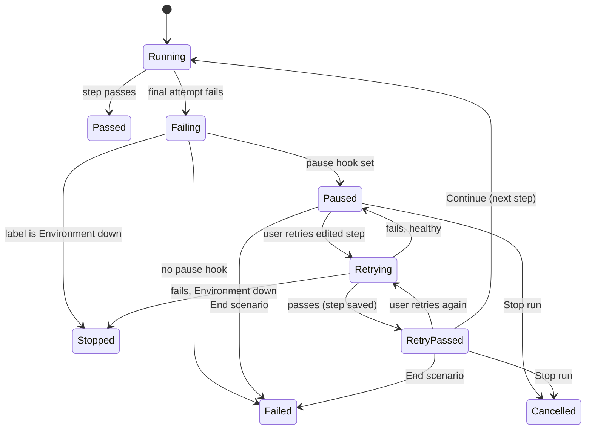
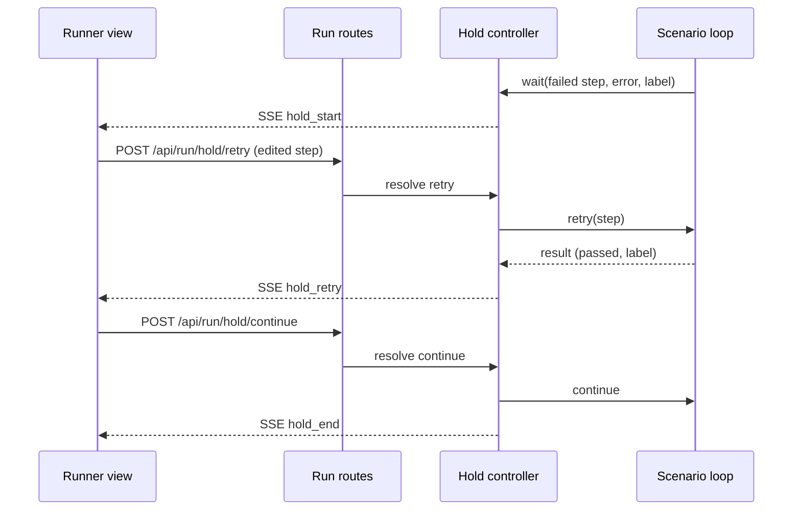

# Pause on Failure - Plan

## Goal Capsule

- **Objective:** Someone writing a scenario can fix a failing step and see whether the fix works in seconds, without replaying every step before it.
- **Means:** An opt-in "pause on failure" run mode in the web GUI that holds the live browser page or Android app on the failed step and re-runs only that step after an edit (KTD1, KTD2).
- **Product authority:** The Product Contract below. Step dependencies and CLI support are not active scope.
- **Stop conditions:** Stop and ask if holding the run makes it impossible to keep `passed + failed + fixed + notRun = total`. Also stop if a run started without the pause option behaves differently in any way.
- **Execution profile:** One branch from `feat/web-gui`, because `development` does not have the web GUI yet. Units land in order U1 to U6, and each unit leaves `pnpm run check` green.
- **Open blockers:** None.

---

## Product Contract

### Summary

Starting a run from the web GUI with "Pause on failure" turned on changes what happens when a step fails. The run pauses, and the browser page or Android app stays on the screen where the step failed. The user edits that step and retries it, as often as needed. Once it passes, they continue the scenario from the next step, or stop. A run that paused and was fixed never counts as a clean pass.

### Problem Frame

Writing a scenario is a loop: run it, watch step 14 fail on a wrong locator, fix the locator, run it again. Each attempt replays steps 1 to 13, including login, seeding and slow Android navigation. That replay is where authoring time goes.

Resuming from saved variables was considered and rejected. The web driver closes its browser context at the end of each scenario (`src/drivers/web.ts`, `endScenario`), and the mobile driver relaunches the app. A resumed step 14 would start on the wrong screen, not logged in.

The tool has little real usage so far, and the consumer project will be set up again from a clean state and run by hand. Faster authoring helps that setup more than anything aimed at CI.

### Key Decisions

- **Keep the live session open instead of resuming from saved variables.** Governs R1, R3. (session-settled: user-directed — chosen over resuming a later run from saved variables: the browser and app would reopen on the wrong screen)
- **Defer step dependencies.** Replaying only a step's declared prerequisites waits until the consumer's scenarios are rebuilt and show whether steps are independent. (session-settled: user-approved — chosen over building dependencies now: UI steps mostly depend on every earlier step, and a missing dependency fails in a misleading way)
- **No CI-facing output.** (session-settled: user-directed — chosen over JUnit output and CI exit codes: the consumer suite runs by hand)
- **Web GUI only.** The CLI keeps its current behavior. Governs R1. (session-settled: user-approved — confirmed in the scoping summary)
- **A fixed run is never green.** Governs R7, R8. (session-settled: user-approved — confirmed in the scoping summary)

### Requirements

**Pausing**

- R1. The web GUI run options offer "Pause on failure", off by default. With it off, a run behaves exactly as it does today.
- R2. With it on, when a step fails after its final attempt and the failure is not labeled "Environment down", the run pauses before the scenario ends. Nothing else runs while it is paused, including later scenarios.
- R3. While paused, the browser page or Android app and the scenario's extracted variables stay as they were when the step failed.
- R4. An "Environment down" failure and a failed setup fixture never pause. They behave as they do today.

**While paused**

- R5. The user can edit the failed step and retry it. A retry runs that one step once, with no automatic retries, on the live session, and reports pass or fail with its failure label.
- R6. The user can end the pause in three ways:
  - **Continue:** available only after a retry passes. The scenario goes on from the next step.
  - **End scenario:** the scenario fails as it would without the pause, and the run moves on.
  - **Stop run:** the run is cancelled, the same as the existing Stop button.
- R7. When a retry passes, the edited step is saved to the scenario, so the fix applies to future runs.
- R8. A retry that fails with "Environment down" ends the pause and stops the run, as R4 describes for normal failures.

**Results**

- R9. A scenario that paused, then passed every remaining step, is "Fixed", neither passed nor failed. A scenario that pauses again later stays "Fixed" if every pause ends in Continue.
- R10. A run with one or more fixed scenarios and no failed ones ends `FAILED` with reason "fixed during run". "Environment down" takes precedence over it, and it takes precedence over "recovered steps (strict)".
- R11. A step that passed on a manual retry is not counted as "recovered".
- R12. The GUI shows the paused state, every manual retry, the "Fixed" scenario badge and the fixed count.

### Acceptance Examples

- AE1. **Covers R2, R5, R6, R9.** Given pause on failure is on and step 3 of 5 fails on a wrong selector, when the user fixes the selector, retries, sees it pass and clicks Continue, then steps 4 and 5 run on the same page. If they pass, the scenario is Fixed.
- AE2. **Covers R6.** Given a paused step, when the user clicks End scenario, then the scenario is Failed with the original label, and the next scenario starts.
- AE3. **Covers R4.** Given pause on failure is on, when the backend dies and the step is labeled Environment down, then the run stops without pausing, and the remaining scenarios are not run.
- AE4. **Covers R10.** Given one Fixed scenario and two Passed ones, then the run is `FAILED` with reason "fixed during run", counted 2 passed, 0 failed, 1 fixed.
- AE5. **Covers R1.** Given pause on failure is off, when a step fails, then the run behaves exactly as today.

### Scope Boundaries

- CLI pause mode.
- Pausing on a failed setup fixture. A fixture has no step to edit.
- A timeout that ends a pause on its own. A pause waits until the user acts or cancels.
- Retrying a step with its configured retry policy. One click is one attempt.
- Editing any step other than the failed one while paused.

#### Deferred to Follow-Up Work

- Step dependencies: replay only a step's declared prerequisites.
- A "Strict" toggle in the GUI. It is a separate gap noted in `docs/domain/runs.md`.

---

## Planning Contract

### Key Technical Decisions

- KTD1. **The pause lives inside the scenario loop, before `endScenario`.** Holding there keeps the driver sessions open with no driver changes, since web and mobile drivers release their session only in `endScenario` (R3). The runner receives an optional pause hook in `RunOptions`. With no hook, the code path is today's (R1).
- KTD2. **The server owns the pause through a hold controller.** The runner awaits a promise from the controller. Server routes resolve it with retry, continue, end-scenario or stop. The controller listens to the run's `AbortSignal`, so the existing Stop and cancel paths end a pause with no extra route (R6).
- KTD3. **Manual retries are stored as extra `step_runs` attempts with a new `manual` column.** Their attempt numbers continue after the automatic ones. Recovered detection ignores manual rows (R11). This keeps every attempt in run history without a new table.
- KTD4. **"Fixed" is a new scenario outcome with its own run count.** The `runs` table gains `fixed_scenarios`, the summary gains `fixed`, and the counts invariant becomes `passed + failed + fixed + notRun = total` (R9). Folding fixed scenarios into failed would show "1 failed" for a scenario that ended passing, which reads wrong.
- KTD5. **The edited step is saved to the scenario only when its retry passes (R7).** Saving failed attempts would leave a broken step in the scenario when the user gives up. The server replaces the step at its index in the stored scenario through `saveScenario` in `src/db/scenarios.ts`. Steps are stored one row per step, so the run's step index is the stored index.
- KTD6. **Split `runScenario` out of `src/runner.ts` first.** The runner is at 499 lines, the file-size budget. Moving `runScenario` to its own module before adding the pause keeps both files under budget.
- KTD7. **The paused state is server state, not just an event.** `ActiveRun` carries the current hold, and `GET /api/run/status` returns it, so a reloaded page shows the pause panel. SSE events report changes as they happen.

### High-Level Technical Design

Scenario step lifecycle with the pause hook:

Request flow while paused:

### Assumptions

- The user keeps the browser headed while authoring. A headless browser can still be paused, but there is nothing to look at.
- One run at a time, which the server already enforces with its 409 response, so one hold controller per active run is enough.

### Risks

- **The live screen can drift while paused.** A user who clicks around in the headed browser changes the state the next step sees. That is acceptable for authoring and is why a fixed run is never green (R10).
- **The scenario changes under the scenario builder.** If the scenario builder has the same scenario open, its unsaved draft can overwrite the saved fix. The runner view shows a toast naming the scenario that was saved.

---

## Implementation Units

### U1. Move `runScenario` into its own module

- **Goal:** Make room in `src/runner.ts` for the pause without passing the file-size budget (KTD6).
- **Requirements:** None directly; enables U2.
- **Dependencies:** None.
- **Files:** `src/runner.ts`, `src/scenario-run.ts` (new), `test/runner.test.ts`.
- **Approach:** Move `runScenario`, its `ScenarioOutcome` type and the step-attempt loop to `src/scenario-run.ts`. `run()` keeps preflight, iteration, summary and finalization. No behavior change.
- **Test scenarios:** Test expectation: none -- pure move; the existing `test/runner.test.ts` suite must pass unchanged.
- **Verification:** `pnpm run check` passes, and `check:size` no longer warns about `src/runner.ts`.

### U2. Pause hook and manual retry in the scenario loop

- **Goal:** Pause on a final failure, retry the edited step on the live session, and continue or end the scenario (R2 to R6, R8).
- **Requirements:** R2, R3, R4, R5, R6, R8, R11; KTD1, KTD3.
- **Dependencies:** U1.
- **Files:** `src/scenario-run.ts`, `src/hold.ts` (new), `src/runner.ts` (the `RunOptions` and `RunEvent` types), `test/hold.test.ts` (new), `test/runner.test.ts`.
- **Approach:**
  1. `src/hold.ts` defines the hold controller: one pending decision at a time, resolved by `retry(step)`, `continue()`, `endScenario()`, and rejected by the abort signal.
  2. After `settle` labels a final step failure, and the label is not Environment down, the loop emits `step_fail` as today, then asks the hook for a decision instead of returning.
  3. A retry substitutes variables into the edited step with the current scope, runs it once, records a `manual` attempt row, runs `checkAssert` and `extract`, and re-runs `settle` on failure.
  4. When a retry passes, the loop also replaces the step in the run's in-memory scenario, so later `--repeat` iterations run the fix too.
  5. Continue moves to the next step index. End scenario returns the original failure, labelled as before.
  6. A fixed scenario calls `endScenario` with `failed = true`, so its failure screenshot and trace are kept.
  7. New events: `hold_start`, `hold_retry` (passed, error, label), `hold_end` (how it ended).
- **Patterns to follow:** The attempt loop and `settle` in the current `runScenario`; cancel handling that throws `Execution cancelled`.
- **Test scenarios:**
  - Covers AE1. A shell step fails, the hook retries it with a fixed command, it passes, the hook continues, the next step runs, and its extracted variable from the retry is visible.
  - Covers AE2. The hook ends the scenario, the outcome is the original failure and label, and no retry rows exist.
  - Covers AE3. The step fails while the re-check reports a service down, and the hook is never called.
  - A retry that fails stays paused and emits `hold_retry` with its label. A second retry that passes allows continue.
  - A retry that fails with Environment down ends the pause and stops the run.
  - Aborting the signal while paused throws `Execution cancelled`, and the scenario is not counted passed.
  - A failed setup fixture does not call the hook.
  - Manual retry rows have `manual = 1` and attempt numbers after the automatic attempts.
  - Under repeat 2, a step fixed in iteration 1 runs in its edited form in iteration 2.
  - Covers AE5. With no hook, a failing step ends the scenario exactly as before.
- **Verification:** The scenario loop can be driven to every state in the state diagram from tests using shell steps.

### U3. Fixed outcome, counts and storage

- **Goal:** Record fixed scenarios and the "fixed during run" reason without breaking counts (R9 to R11).
- **Requirements:** R9, R10, R11; KTD3, KTD4.
- **Dependencies:** U2.
- **Files:** `src/db/connection.ts`, `src/db/runs.ts`, `src/run-result.ts`, `src/runner.ts`, `src/scenario-run.ts`, `test/db.test.ts`, `test/runner.test.ts`.
- **Approach:**
  1. Add `step_runs.manual` and `runs.fixed_scenarios`, with the same open-time column backfill used for `failure_label`.
  2. `ScenarioOutcome` gains `fixed`. The summary gains `fixed`, and `run()` counts it apart from passed and failed.
  3. `settleStatus` applies reason precedence: environment down, then fixed during run, then recovered steps (strict). `resultLine` shows the fixed count.
  4. Recovered derivation skips manual rows.
- **Patterns to follow:** How `recovered_steps`, `not_run_scenarios` and `ENVIRONMENT_DOWN` were added.
- **Test scenarios:**
  - Covers AE4. One fixed and two passed scenarios give `FAILED`, reason "fixed during run", counts 2/0/1, and the counts add up.
  - Environment down in a later scenario takes precedence over an earlier fix.
  - A fixed run with a recovered step under strict reports "fixed during run".
  - A step that passed on a manual retry after one failed automatic attempt is not counted recovered.
  - A database created before these columns opens and gains them.
- **Verification:** Summary, `runs` row and result line agree for every row of the outcome table in `docs/domain/runs.md`.

### U4. Server routes and hold state

- **Goal:** Let the GUI start a paused run, act on a pause, and see it after a reload (R1, R5 to R7).
- **Requirements:** R1, R5, R6, R7; KTD2, KTD5, KTD7.
- **Dependencies:** U2, U3.
- **Files:** `src/server/state.ts`, `src/server/routes/runs.ts`, `test/server.test.ts`.
- **Approach:**
  1. `POST /api/run` accepts `pauseOnFailure`. When set, it creates a hold controller on `ActiveRun` and passes its hook to the runner.
  2. New entries in `src/server/routes/runs.ts`: `POST /api/run/hold/retry` with the edited step, `POST /api/run/hold/continue`, and `POST /api/run/hold/end-scenario`. Each returns 409 when no pause is pending, and continue returns 409 until a retry has passed.
  3. Retry validates the step with `checkSteps` before running it, and returns 400 with the problems. It also returns 400 when the step's target is not one the run prepared, since its driver does not exist.
  4. When a retry passes, the server saves the step into the stored scenario at its index (KTD5).
  5. `GET /api/run/status` includes the pending hold: scenario, step index, step, error, label and whether a retry has passed.
  6. Route handlers read `state.activeRun` directly, per the project's server-state rule.
- **Patterns to follow:** The existing `/api/run` and `/api/run/stop` entries; `POST /api/scenarios` for validation and saving.
- **Test scenarios:**
  - A run started with `pauseOnFailure` pauses on a failing shell step, and status reports the hold.
  - Retry with a fixed step passes, and the stored scenario now holds the edited step.
  - Retry with an invalid step returns 400 and does not run it.
  - Retry with a target the run did not prepare returns 400.
  - Continue before a passing retry returns 409.
  - Hold routes return 409 when no run is paused.
  - Stop while paused cancels the run, and the run is stored `CANCELLED`.
- **Verification:** A paused run can be driven to completion through HTTP alone.

### U5. Runner view: option, pause panel and results

- **Goal:** Give the user the pause option, a panel to edit and retry the failed step, and the Fixed results (R1, R5, R6, R12).
- **Requirements:** R1, R5, R6, R12.
- **Dependencies:** U4.
- **Files:** `ui/src/views/runner/RunControls.tsx`, `ui/src/views/runner/useRunOptions.ts`, `ui/src/views/runner/RunnerView.tsx`, `ui/src/views/runner/PausePanel.tsx` (new), `ui/src/views/runner/usePause.ts` (new), `ui/src/views/runner/executionTree.ts`, `ui/src/views/runner/runCounts.ts`, `ui/src/views/runner/RunStatusBar.tsx`, `ui/src/views/runner/StepTreePane.tsx`, `test/ui-helpers.test.ts`, `test/ui/runner.test.ts`.
- **Approach:**
  1. A "Pause on failure" checkbox in the run options, sent with the run request.
  2. `usePause` holds the pending hold from SSE events and from status on load, and wraps the three hold routes.
  3. `PausePanel` shows the failed step's name, error and label, an editor for that step, and Retry, Continue, End scenario and Stop run buttons. Continue is disabled until a retry passes. The editor reuses the scenario builder's JSON step editing rather than a second designer.
  4. The step tree shows each manual retry, and a `Fixed` badge on the scenario. The status bar shows a Fixed count above zero and a "Fixed During Run" badge.
  5. After a passing retry saves the step, a toast names the scenario that was updated (see Risks).
  6. Pure helpers for counts and tree updates get unit tests.
- **Patterns to follow:** `DESIGN.md` for `Panel`, `Button`, `Badge`, `Checkbox` and Title Case badges; the failure-label and recovered badges added to `StepTreePane.tsx`; `ui/src/views/scenario-builder/StepInspector.tsx` JSON mode.
- **Test scenarios:**
  - `executionTree` applies `hold_start`, `hold_retry` and `hold_end` and marks the scenario Fixed after a continue.
  - `runCounts` includes fixed, and passed plus failed plus fixed plus not run equals total.
  - Smoke: start a run with Pause on failure against a seeded failing shell step, see the pause panel, edit the command, retry, see it pass, click Continue, and see a Fixed badge and the "Fixed During Run" status.
  - Smoke: End scenario from the pause panel shows the scenario Failed and the run moves on.
- **Verification:** `pnpm run test:ui` passes with the new smoke flows.

### U6. Domain docs

- **Goal:** Keep `docs/domain/` in step with the new lifecycle, schema and invariant.
- **Requirements:** All; project rule to sync domain docs.
- **Dependencies:** U3, U4, U5.
- **Files:** `docs/domain/runs.md`, `docs/domain/scenarios.md`.
- **Approach:** In `runs.md`, add the two columns to the schema, a "Pause on failure" section with the lifecycle, the reason precedence and new outcome rows, the updated counts invariant, the hold routes in the API table, and the pause panel and Fixed badge in the UI section. In `scenarios.md`, note that a passing retry saves the edited step.
- **Test scenarios:** Test expectation: none -- documentation only.
- **Verification:** Every new column, route, event, reason and badge in the code appears in `docs/domain/runs.md`.

---

## Verification Contract

| Gate | Command | When |
|---|---|---|
| Lint and format | `pnpm exec biome check --write` | After every unit |
| Typecheck, size, boundary, Tailwind, unit tests | `pnpm run check` | After every unit |
| UI smoke tests | `pnpm run test:ui` | After U5, and before push (pre-push hook) |

Manual check, the user's: run one consumer scenario with Pause on failure, break a step on purpose, fix it in the panel, and continue.

## Definition of Done

- Every requirement R1 to R12 has a passing test or smoke flow, and AE1 to AE5 are covered as cited.
- A run without Pause on failure produces the same summary, rows and events as before, shown by the unchanged existing tests.
- `pnpm run check` and `pnpm run test:ui` pass, and `check:size` shows no new warnings.
- `docs/domain/runs.md` and `docs/domain/scenarios.md` describe the shipped behavior.
- No leftover code from abandoned approaches remains in the diff.
