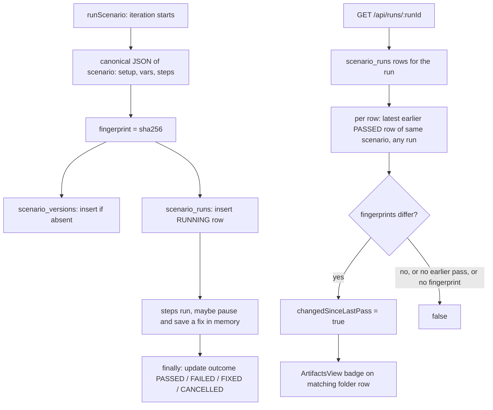

# Pin Each Run to the Scenario It Ran - Plan

## Goal Capsule

- **Objective:** Someone looking at a red run can tell whether the scenario itself changed since it last passed, without remembering or reconstructing past edits.
- **Means:** Record a content fingerprint and a deduplicated snapshot for every scenario-iteration a run executes, then derive a "Changed Since Last Pass" marker at read time (KTD1, KTD2, KTD4).
- **Product authority:** The Product Contract below. The diff view, snapshot pruning and per-step history are not active scope.
- **Stop conditions:** Stop and ask if recording a scenario-iteration would change an existing exit code, `summary.json` field, run event or `step_runs` row. Also stop if a scenario loaded from the database and the same scenario exported and re-imported produce different fingerprints and canonicalization (KTD3) cannot reconcile them.
- **Execution profile:** One branch cut from `feat/web-gui`, which is ahead of `development` and holds pause on failure and step UUIDs. Units land in order U1 to U5, and each unit leaves `pnpm run check` green.
- **Finishing:** Local fast-forward merge into `feat/web-gui` per `CLAUDE.md`. No push or PR unless the user asks.
- **Open blockers:** None.

---

## Product Contract

### Summary

Every run records which version of each scenario it ran, once per iteration, for CLI and GUI runs alike. The Artifacts view marks a scenario-iteration "Changed Since Last Pass" when its content differs from the last time that scenario passed.

### Problem Frame

Since commit `4fdf4ac`, scenarios live only in SQLite and the GUI edits them in place. Git no longer records how a scenario changed, and run history stores only step outcomes keyed by step id. When a scenario that passed yesterday fails today, nothing says whether the scenario was edited in between or the product broke. Pause on failure makes this sharper: a fix saved mid-run changes the stored scenario while the run is still going.

The tool has little real usage yet, so this is preventive. Pinning is cheap now and cannot be backfilled later: a run that did not record its scenario content has lost it for good. The ideation's per-step history (idea 2), cross-channel timeline (idea 4) and resume (idea 7) all build on knowing what ran.

### Key Decisions

- **Pin per scenario-iteration, with snapshots stored once and shared by fingerprint.** Handles `--repeat` and a fix saved during a pause. Governs R1, R3. (session-settled: user-approved — chosen over a fingerprint on every step run, which needs regrouping to answer a scenario-level question, and over one fingerprint per run, which cannot say which scenario changed)
- **Store steps as written, with placeholders intact.** Governs R2. (session-settled: user-approved — chosen over storing substituted steps, which would write `${env.*}` secrets such as passwords and tokens into `.e2e/e2e.db`; nothing in `src/` redacts them)
- **The first UI slice is a "Changed Since Last Pass" badge only.** Governs R6, R7. (session-settled: user-approved — chosen over storage plus API only, and over a full side-by-side diff view)
- **Only what changes what runs counts as a change.** Steps, setup fixture names and variables count. Scenario name, description and ids do not. Governs R2, R5. (session-settled: user-approved — chosen over fingerprinting the whole scenario record, which would flag a rename as a change)
- **"Last pass" looks across all environments.** Governs R5. (session-settled: user-approved — chosen over the same environment only: scenario content does not depend on the environment)

### Requirements

**Recording**

- R1. Every scenario-iteration a run starts records the scenario's fingerprint, its outcome, and its artifacts folder, for CLI and GUI runs. Scenario-iterations the run never reached record nothing.
- R2. The fingerprint covers the scenario's steps, setup fixture names and variables, as written, with placeholders unsubstituted. It ignores scenario name, description, step ids and action ids.
- R3. The content behind each fingerprint is stored once and can be read back later. A fix saved during a pause does not change the fingerprint of the iteration in progress. The next iteration records the fixed content.
- R4. Recording is best effort: a failed write never fails a step, a scenario or the run, and never changes the exit code, `summary.json` or run events.

**Changed since last pass**

- R5. A scenario-iteration is "changed since last pass" when an earlier scenario-iteration of the same scenario, in any environment, passed with a different fingerprint, and that passing iteration is the most recent passing one. Only a plain pass counts. A fixed, failed, cancelled or still-running iteration never counts as the last pass.
- R6. When there is no earlier pass, or the earlier pass has no fingerprint because it ran before this change, the scenario-iteration is not marked.
- R7. The Artifacts view shows a `Changed Since Last Pass` badge on each marked scenario-iteration of the selected run, whatever that iteration's own outcome.
- R8. `GET /api/runs/:runId` returns each scenario-iteration's fingerprint, outcome, artifacts folder and changed marker.

**Docs**

- R9. `docs/domain/runs.md` and `docs/domain/scenarios.md` describe the new tables, the fingerprint rule and the marker, in the same change.

### Acceptance Examples

- AE1. Covers R3, R5. `--repeat 2` run: iteration 1 pauses, the user saves a fix, and the scenario ends fixed. Iteration 1 keeps the pre-fix fingerprint. Iteration 2 records the fixed fingerprint and passes. A later run with the same content is not marked, because iteration 2 is its last pass.
- AE2. Covers R2, R5. A scenario passes, then is renamed in the GUI, then fails. The failed iteration is not marked: the rename did not change the fingerprint.
- AE3. Covers R5, R7. A scenario passes, a step's selector is edited, and it fails. The failed iteration shows `Changed Since Last Pass`. After the user reverts the selector, the next run's iteration is not marked: it matches the last pass again.
- AE4. Covers R6. A scenario whose only earlier pass ran before this change fails. It is not marked.

### Scope Boundaries

- Changes outside the scenario record are not in the fingerprint: a fixture's command, platform and environment configuration, and `${env.*}` values. A fixture renamed in the scenario's setup list does count.
- The CLI result line and `summary.json` are unchanged.

#### Deferred to Follow-Up Work

- Side-by-side diff of a scenario-iteration against its last pass, built on the stored snapshots.
- Pruning snapshots no run references any more, alongside run retention when that exists.
- A marker in the runner view's live results.

#### Considered and not built

- **Recording the substituted step JSON on each step run.** Rejected for secrets (see Key Decisions). Revisit if a redaction layer exists.
- **Backfilling fingerprints for old runs.** The stored scenario may have changed since those runs, so a backfilled fingerprint would claim content that may not be what ran.

---

## Planning Contract

### Key Technical Decisions

- KTD1. **Two tables, one concept module.** `scenario_runs` holds one row per run, scenario and iteration. `scenario_versions` holds one row per fingerprint with the canonical JSON. Both live in `src/db/scenario-runs.ts` and their schema in `src/db/connection.ts`, following the "one concept per file" rule. `step_runs` is not touched.
- KTD2. **The fingerprint is a SHA-256 hex digest of canonical JSON, computed by a pure helper in `src/scenario-version.ts`.** The snapshot stored under that digest is the same canonical JSON, so the stored content is exactly what was hashed. A content-addressed insert that ignores an existing fingerprint dedupes snapshots for free.
- KTD3. **Canonical form drops what does not change behavior and smooths over storage differences.** It keeps only `setup`, `vars` and `steps`, removes `id` from every step and action, drops keys whose value is `null` or `undefined`, treats a missing `setup` as `[]` and missing `vars` as `{}`, and sorts object keys recursively. Array order is kept. Reason: a scenario read from SQLite and the same scenario read from JSON can differ in absent-versus-null fields, and that must not read as a change.
- KTD4. **"Changed since last pass" is derived at read time, not stored.** This follows the precedent that "recovered" is derived from rows (`docs/domain/runs.md`, section 2). The lookup takes the latest `PASSED` row for the same `scenario_id` whose `started_at` is earlier than the row being judged, from any run, and compares fingerprints. A stored flag would go stale when an older run is the reference.
- KTD5. **The runner writes the row at scenario start and updates it at scenario end.** `runScenario` in `src/scenario-run.ts` computes the fingerprint from the `scenario` object at iteration start, saves the snapshot, and inserts a `RUNNING` row. Its existing `finally` block updates the outcome. Because a saved fix replaces `scenario.steps[index]` in memory, the next iteration's start sees the fixed content without extra work (R3). A process killed mid-scenario leaves `RUNNING`, which never counts as a pass.
- KTD6. **Outcome values are `RUNNING`, `PASSED`, `FAILED`, `FIXED` and `CANCELLED`.** A cancel wins over a failure, matching the run-level rule. `FIXED` mirrors the existing fixed-scenario concept (`docs/domain/runs.md`, section 4).
- KTD7. **The row stores the artifacts folder name, and the UI matches on it.** The folder is `scenarioId` or `scenarioId-iteration`, decided in `src/runner.ts`. The UI keys the badge to the folder name from the API, so the UI never re-derives the folder naming rule. This also covers a `--repeat` run that stopped early.

### High-Level Technical Design

Per-row outcome lifecycle: `RUNNING` then exactly one of `PASSED`, `FAILED`, `FIXED` or `CANCELLED`. Only `PASSED` is eligible as a last pass.

### Risks

- **False "changed" from storage shape drift.** A step that gains a defaulted field on save (for example a new `retry` default written by the builder) changes the fingerprint without any behavior change. KTD3 handles null and absent values. A test in U1 pins a database round trip to an identical fingerprint. Remaining drift from real defaults is acceptable: the badge says "changed", which is literally true.
- **Database growth.** One row per scenario-iteration plus one snapshot per distinct content. Snapshots dedupe, so growth tracks edits, not runs. Pruning is deferred.

---

## Implementation Units

### U1. Canonical scenario fingerprint

- **Goal:** A pure function turns a scenario into canonical JSON and its fingerprint.
- **Requirements:** R2. KTD2, KTD3.
- **Dependencies:** None.
- **Files:** `src/scenario-version.ts` (new), `test/scenario-version.test.ts` (new).
- **Approach:** Takes a `Scenario` (`src/db/scenarios.ts`) and returns `{ fingerprint, json }`. Uses `node:crypto` for the hash.
- **Patterns to follow:** Pure helpers with `node:test` suites, such as `src/run-result.ts` with `test/runner.test.ts`.
- **Test scenarios:**
  - Same scenario twice gives the same fingerprint.
  - Changing a step's selector, a variable value, the setup list, or step order changes the fingerprint.
  - Changing scenario name, description, a step id or an action id leaves the fingerprint unchanged.
  - Keys in a different order give the same fingerprint.
  - A field set to `null` and the same field absent give the same fingerprint, as do missing and empty `setup` and `vars`.
  - `${env.TOKEN}` stays as literal text in the JSON.
  - Covers AE2. A scenario saved with `saveScenario` and read back with `getScenario` matches the fingerprint of the object it was saved from.
- **Verification:** Unit tests pass under `pnpm run check`.

### U2. Storage for scenario runs and versions

- **Goal:** Persist scenario-iterations and snapshots, and answer the changed-since-last-pass question.
- **Requirements:** R1, R3, R5, R6. KTD1, KTD4, KTD6, KTD7.
- **Dependencies:** None.
- **Files:** `src/db/connection.ts`, `src/db/scenario-runs.ts` (new), `test/scenario-runs.test.ts` (new).
- **Approach:**
  1. Add both tables to the `openDatabase` schema block with `CREATE TABLE IF NOT EXISTS`, plus an index on `scenario_runs(scenario_id, started_at)`. New tables need no `addMissingColumn`.
  2. `scenario_runs` columns: `run_id`, `scenario_id`, `iteration`, `fingerprint`, `status`, `artifacts_dir`, `started_at`, `completed_at`. The primary key is `(run_id, scenario_id, iteration)`.
  3. `scenario_versions` columns: `fingerprint` primary key, `scenario_json`, `created_at`.
  4. Functions: save a version (insert or ignore), save or update a scenario run (upsert on the key), list a run's scenario runs with the derived `changedSinceLastPass`, and read a version by fingerprint.
- **Patterns to follow:** `src/db/runs.ts` for upserts, row mapping and camelCase records.
- **Test scenarios:**
  - Saving the same fingerprint twice keeps one version row with the original JSON.
  - Upserting a `RUNNING` row and then `FAILED` leaves one row with `FAILED` and `completed_at` set.
  - Covers AE3. A failed row whose latest earlier `PASSED` row has a different fingerprint is changed. One with the same fingerprint is not.
  - Covers AE4. With no earlier pass, or an earlier pass from before this change (no row), the row is not changed.
  - An earlier `FIXED`, `FAILED`, `CANCELLED` or `RUNNING` row with a different fingerprint is ignored. The lookup goes back to the latest `PASSED` one.
  - A pass from a different environment counts as the last pass.
  - A later pass of the same scenario does not affect an earlier row's marker.
  - Opening a database created before this change adds both tables without touching existing rows.
- **Verification:** Unit tests pass. Opening an existing `.e2e/e2e.db` adds the tables.

### U3. Runner records each scenario-iteration

- **Goal:** Every run writes its scenario-iterations and snapshots as they start and end.
- **Requirements:** R1, R3, R4. KTD5, KTD6, KTD7.
- **Dependencies:** U1, U2.
- **Files:** `src/scenario-run.ts`, `test/runner.test.ts`, `test/runner-pause.test.ts`.
- **Approach:**
  1. At the top of `runScenario`, before setup fixtures run, fingerprint the `scenario`, save the version, and insert the `RUNNING` row. The artifacts folder name is `basename(dir)`.
  2. In the existing `finally`, map the outcome: cancelled if `signal?.aborted`, else `FIXED`, `FAILED` or `PASSED` from the values already computed there.
  3. Wrap both writes in the same best-effort `try`/`catch` as the existing `record` helper. Skip them when `db` is undefined.
- **Patterns to follow:** The `record` helper and the `scenario_end` mapping already in `runScenario`. Tests seed and read the project database through `test/runner-project.ts`, which already exposes the latest run.
- **Test scenarios:**
  - A passing run writes one `PASSED` row per scenario and one version per distinct content.
  - `--repeat 2` with unchanged content writes two rows with the same fingerprint and one version.
  - A setup fixture failure writes a `FAILED` row.
  - An environment-down stop writes rows only for scenario-iterations that started.
  - A cancelled run writes `CANCELLED` for the scenario in progress.
  - Covers AE1. Pause, save a fix, continue: iteration 1 is `FIXED` with the old fingerprint, iteration 2 records the new fingerprint.
  - A run with no database file still runs and writes nothing.
  - Existing runner tests pass unchanged, which shows events, `summary.json` and exit codes did not move.
- **Verification:** `pnpm run check` passes, and no existing assertion changed.

### U4. API and Artifacts view badge

- **Goal:** The run detail returns scenario-iterations, and the Artifacts view shows the badge.
- **Requirements:** R7, R8. KTD7.
- **Dependencies:** U2, U3.
- **Files:** `src/server/routes/runs.ts`, `ui/src/types.ts`, `ui/src/components/ArtifactsView.tsx`, `test/server.test.ts`, `test/ui/runner.test.ts`.
- **Approach:**
  1. The `GET /api/runs/:runId` handler adds `scenarioRuns` to its response, read in the same `withDb` call as `getRun`. When there is no database, return an empty list.
  2. In the "Result Files & Reports" list, each row whose folder name matches a `scenarioRuns` entry with `changedSinceLastPass` shows a warning `Badge` labeled `Changed Since Last Pass`, in Title Case per `DESIGN.md`.
  3. `ArtifactsView.tsx` is at 461 lines against the ~500-line budget. If the badge pushes it over, move the "Result Files & Reports" list into its own component file next to it instead of growing the view.
- **Patterns to follow:** How the Step Runs tab renders `Recovered` and `Manual Retry` badges in `ui/src/components/ArtifactsView.tsx`.
- **Test scenarios:**
  - `GET /api/runs/:runId` for a seeded run returns `scenarioRuns` with fingerprint, status, artifacts folder and marker.
  - A run detail with no database returns an empty `scenarioRuns` list and still 200s.
  - Smoke, covers AE3: run a passing scenario, change one step through `POST /api/scenarios` so that it fails, and run again. The second run's artifacts tab shows `Changed Since Last Pass` on that scenario's row. The first run's row does not.
- **Verification:** `pnpm run check` and `pnpm run test:ui` pass.

### U5. Domain docs

- **Goal:** Domain docs describe what shipped.
- **Requirements:** R9.
- **Dependencies:** U1 to U4.
- **Files:** `docs/domain/runs.md`, `docs/domain/scenarios.md`.
- **Approach:**
  1. `runs.md`: add both tables to section 1, and add a section on scenario versions covering the fingerprint rule (R2), the per-iteration lifecycle (KTD6) and the derived marker (R5, R6).
  2. In `runs.md`, also add `scenarioRuns` to the API table, the badge to the UI section and the badge list, and an invariant: a run records only content it actually started.
  3. `scenarios.md` section 5: one line saying each iteration records its fingerprint at start, and a fix saved during a pause applies from the next iteration.
- **Test expectation:** none -- documentation only.
- **Verification:** Every table, column, status value and badge named in the docs matches the code.

---

## Verification Contract

| Gate | Command | When |
|---|---|---|
| Lint and format | `pnpm exec biome check --write` | After every unit |
| Typecheck, size, boundary, Tailwind, unit tests | `pnpm run check` | After every unit |
| UI smoke tests | `pnpm run test:ui` | After U4, and before any push (pre-push hook) |

Manual check (yours to do): in the consumer project, run a scenario, edit one step in the GUI, run it again, and confirm the badge in Reports.

## Definition of Done

- R1 to R9 each have a passing test, smoke flow or doc change, and AE1 to AE4 are covered as cited.
- Existing tests pass without edits to their assertions, which shows runs without this feature's tables behave as before.
- `pnpm run check` and `pnpm run test:ui` pass, and `check:size` shows no new warnings.
- `docs/domain/runs.md` and `docs/domain/scenarios.md` match the shipped behavior.
- No leftover code from abandoned approaches remains in the diff.
