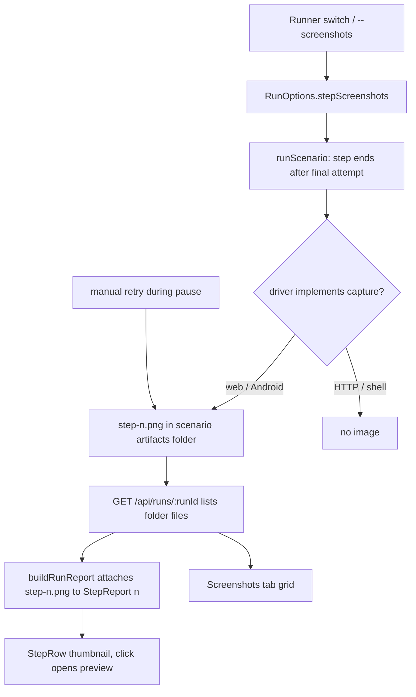

# Step Screenshots - Plan

## Goal Capsule

- **Objective:** After a run, a user can see what the app's screen looked like at the end of each web and Android step, including steps that passed.
- **Means:** a run-level option that makes the step runner ask each screen driver for one image per step, matched to report rows by file name (KTD1, KTD2).
- **Product authority:** This Product Contract. Scenario format, failure artifacts, and run outcomes stay as they are.
- **Stop conditions:** Stop and ask if capturing would need a database schema change, or if it would change any run, scenario, or step outcome.
- **Open blockers:** None.
- **Finishing:** `ce-work` implements on a feature branch from `development` and merges locally, fast-forward only, per `CLAUDE.md`.

---

## Product Contract

Product Contract preservation: changed: R6, failed steps get their own image instead of reusing the failure screenshot. The user chose this after planning found that the failure screenshot is taken when the scenario ends, which after a pause is the wrong moment. R7 was clarified to include manual retries. The rest is unchanged.

### Summary

A run-level "Screenshot every step" option, offered as a Runner switch and a CLI flag. When it is on, every web and Android step saves one image when it finishes. Reports shows each image as a thumbnail on its step row.

### Problem Frame

A passing run records which steps passed, but not what the app showed. Today the only ways to check that a flow looked right are to watch the run live, or to add `screenshot` actions to scenarios by hand. That action exists only for web; mobile has none. The web trace already records a screenshot after every action, but it is kept only when a scenario fails. A passing scenario keeps no images at all.

### Key Decisions

- **Run-level option, not per-action or per-scenario.** Visual review is something a user wants for a particular run, not a property of the scenario. A run-level switch covers a whole flow without editing any scenario. Governs R1, R2, R3. (session-settled: user-directed — chosen over a per-action checkbox saved in the scenario: ticking every action to cover a flow is too much authoring, and the choice belongs to the run)
- **One image per step, taken when the step ends.** This matches "what each step looked like", keeps the image count low, and keeps the slowdown small, mostly on Android. Governs R4. (session-settled: user-directed — chosen over one image after every action and over a two-level toggle)
- **A failed step gets its own image, taken at failure.** The existing failure screenshot is taken when the scenario ends, so after a pause it shows the screen after the user's fixes. Governs R6. (session-settled: user-directed — chosen over reusing `web-failure.png` / `mobile-failure.png`: wrong moment after a pause, and ambiguous when a scenario has both)
- **Thumbnails inline on step rows.** The user reads the flow top to bottom with each step next to its image. Governs R9, R10. (session-settled: user-directed — chosen over a grouped gallery in the Screenshots tab and over showing both)
- **Behaves like the other Runner options.** The switch is off by default and follows the same lifetime as pause-on-failure and the other sidebar options. Those are not saved across a page reload today. Governs R2.

### Requirements

**Turning it on**

- R1. A run can be started with "Screenshot every step" on or off. Scenario files and the scenario builder do not change.
- R2. The Runner shows the option as a switch next to the other run options. It is off by default.
- R3. The CLI run command accepts a flag that turns the option on for that run.

**Capture**

- R4. When the option is on, each web and Android step saves one image of the screen as it is when the step finishes, whether the step passed or failed.
- R5. HTTP and shell steps never get an image, because they have no screen.
- R6. A failed step's image is taken right after its last automatic attempt, before any pause. The scenario's existing failure screenshot is still saved as today.
- R7. A step keeps only the image from its final attempt, automatic or manual. A step fixed by a manual retry during a pause shows the screen after the passing retry.
- R8. With the option off, runs save exactly the artifacts they save today and take no extra time.

**Viewing**

- R9. In Reports, each step row in a scenario's result card shows a thumbnail of that step's image when one exists.
- R10. Clicking a thumbnail opens the existing full-size screenshot preview.
- R11. The images also appear in the Screenshots tab's existing grid, alongside failure screenshots.

### Acceptance Examples

- AE1. **Covers R4, R5.** Given the option is on and a scenario has a web step, an HTTP step, and an Android step that all pass, when the run ends, then the web and Android step rows show thumbnails and the HTTP step row shows none.
- AE2. **Covers R6.** Given the option is on, when a web step fails, then that step row shows an image taken at the failure, and the scenario still keeps `web-failure.png` and its trace.
- AE3. **Covers R7.** Given the option is on and a step fails once and passes on retry, then its thumbnail shows the screen after the passing attempt.
- AE4. **Covers R8.** Given the option is off, when a scenario passes, then it keeps no images, as today.
- AE5. **Covers R2.** Given a user turned the switch on and then reloaded the GUI, then the switch is off again, like pause-on-failure.
- AE6. **Covers R7.** Given the option and pause-on-failure are on, when a step fails, the user edits it, and the manual retry passes, then the step row shows the screen after that retry.

### Scope Boundaries

- Per-action screenshots, and a setting stored on scenarios or actions.
- A mobile `screenshot` action for the scenario builder.
- Saving Runner options across page reloads.
- Cleanup or retention rules for run artifacts. Runs with the option on use more disk.
- Image comparison between runs, or visual regression checks.
- Keeping the Playwright trace for passing scenarios.
- Considered and not built: retrying a failed capture. A missing thumbnail is visible in Reports and costs nothing to rerun; add retries only if captures turn out to fail often.

### Dependencies / Assumptions

- Android runs get slower with the option on, because each step adds one `adb screencap`. The cost per step has not been measured here.
- The Screenshots tab already lists every image in a run's result folders, so R11 needs no new grouping.

### Sources / Research

- `src/scenario-run.ts`: `runScenario`, `attemptStep`, `holdStep`, and the `endScenario` call that saves failure evidence when a scenario ends.
- `src/drivers/types.ts`: the `Driver` interface, with its optional `endScenario` and `close`.
- `src/drivers/web.ts`: the existing `screenshot` action, the failure screenshot and the trace kept only on failure (`endScenario`).
- `src/drivers/mobile.ts`: failure-only `adb exec-out screencap -p` in `endScenario`.
- `src/run-report.ts`: `buildRunReport` collapses attempts into one `StepReport` per step and attaches the scenario folder's files.
- `src/server/routes/runs.ts`: `POST /api/run` builds `RunOptions` from the request body; `GET /api/runs/:runId` lists each scenario folder's files.
- `ui/src/views/runner/useRunOptions.ts` and `ui/src/views/runner/RunControls.tsx`: Runner options, including `pauseOnFailure`, held in component state.
- `ui/src/views/reports/ScenarioResultCard.tsx` (`StepRow`, `Files`) and `ui/src/views/reports/ReportsView.tsx`: step rows, the Screenshots tab and the full-size preview.

---

## Planning Contract

### Key Technical Decisions

- KTD1. **Drivers capture on request through a new optional `Driver` method.** The step runner calls it with a target file path after a step's final attempt. Only `WebDriver` and `MobileDriver` implement it, so HTTP and shell steps are skipped with no target checks (R5). This mirrors the existing optional `endScenario`.
- KTD2. **Images are matched to steps by file name, with no schema change.** Each image is `step-<n>.png`, where `<n>` is the 1-based step index, in the scenario-iteration's existing artifacts folder. That folder is already one per iteration, so `--repeat` needs no extra naming. `buildRunReport` attaches the file to its `StepReport`. A rerun attempt overwrites the file, which gives R7 for free. Storing paths on `step_runs.artifacts_path` was rejected: that column already means "folder with failure evidence" on failed rows, and a file-name rule keeps the report working from the files alone.
- KTD3. **A failed capture never fails the step.** Capture errors are caught, logged as one detail line, and leave the step without an image. The step's status, duration and failure label are unchanged (R8 for outcomes).
- KTD4. **Capture runs outside the step's measured time.** The runner takes the image after it records the step's duration, so step timings stay comparable with runs that had the option off.
- KTD5. **Web step images capture the viewport, not the full page.** The viewport is what the user saw, and long pages stay small. The failure screenshot in `endScenario` stays full-page.
- KTD6. **The option travels the same path as `pause`.** It is a `RunOptions` field, read by `runScenario` through its `run` argument, set by `POST /api/run` from a request-body boolean and by a new CLI flag. Name: `stepScreenshots` in code, `--screenshots` on the CLI.

### High-Level Technical Design

Where a step's image comes from, and how it reaches the step row:

### Assumptions

- Playwright's page screenshot and `adb exec-out screencap -p` both work at any point between steps while the scenario's page or device session is open. Both are already used at scenario end.

---

## Implementation Units

### U1. Run option plumbing

**Goal:** Carry "Screenshot every step" from the CLI and the HTTP API into `runScenario`.

**Requirements:** R1, R3, R8

**Dependencies:** None

**Files:**
- `src/runner.ts`
- `src/cli.ts`
- `src/server/routes/runs.ts`
- `test/runner.test.ts`

**Approach:**
1. Add an optional `stepScreenshots` boolean to `RunOptions` and pass it to `runScenario` next to `pause` (KTD6).
2. Add `--screenshots` to the CLI options and help text, setting it on the run's options.
3. Read a `stepScreenshots` boolean from the `POST /api/run` body into `RunOptions`.

**Patterns to follow:** `pause` / `pauseOnFailure` in `src/server/routes/runs.ts` and `src/runner.ts`. `strict` in `src/cli.ts` for a boolean CLI flag.

**Test scenarios:**
- A run with the option off saves no `step-*.png` files in its artifacts folder. Covers AE4.
- `--help` output lists `--screenshots`.

**Verification:** A CLI run with `--screenshots` and a `POST /api/run` with `stepScreenshots: true` both reach `runScenario` with the option set.

### U2. Driver capture method

**Goal:** Let web and Android drivers save one image of the current screen to a given path.

**Requirements:** R4, R5

**Dependencies:** None

**Files:**
- `src/drivers/types.ts`
- `src/drivers/web.ts`
- `src/drivers/mobile.ts`
- `test/web-driver.test.ts`
- `test/mobile-driver.test.ts`
- `test/fake-adb.ts`

**Approach:**
1. Add an optional capture method to `Driver` that takes a file path (KTD1).
2. `WebDriver` saves a viewport screenshot of its open page (KTD5). With no open page it does nothing.
3. `MobileDriver` runs the same `exec-out screencap -p` call `endScenario` uses, writing to the given path. Share that call between the two methods instead of duplicating it.
4. `HttpDriver` and `ShellDriver` stay unchanged.

**Patterns to follow:** `endScenario` in `src/drivers/web.ts` and `src/drivers/mobile.ts`.

**Test scenarios:**
- Web: after a `navigate` step, capturing to a temp path writes a non-empty PNG.
- Web: capturing before any step ran writes nothing and does not throw.
- Mobile: with the fake adb answering `exec-out screencap -p`, capturing writes its bytes to the given path.
- Mobile: when screencap exits non-zero, capturing rejects or reports failure, and writes no file.

**Verification:** Both drivers write a PNG on request. The HTTP and shell drivers have no capture method.

### U3. Capture in the step runner

**Goal:** Take one image per step at the right moment when the option is on.

**Requirements:** R4, R5, R6, R7, R8

**Dependencies:** U1, U2

**Files:**
- `src/scenario-run.ts`
- `test/step-screenshots.test.ts`

**Approach:**
1. After a step's automatic attempts finish and its duration is measured (KTD4), capture to `step-<n>.png` in the scenario's artifacts folder (KTD2). Do this for passed and failed steps, before `settle` and before any pause (R6).
2. In `holdStep`, capture again after each manual retry, overwriting the file, so the final attempt wins (R7).
3. Skip capture when the option is off, when the step's driver has no capture method, or when the run was cancelled.
4. Catch capture errors and log one detail line (KTD3).

**Execution note:** Start with the fake-driver test for the passed, failed and HTTP cases, then add the capture calls.

**Patterns to follow:** The best-effort `record` and `pin` helpers in `runScenario`, which never let a history write fail a step.

**Test scenarios:**
Each test calls `runScenario` directly with a fake capturing driver and a fake non-capturing driver.
- Covers AE1. With the option on, a passing capturing step writes `step-1.png` and a non-capturing step writes nothing.
- Covers AE2. A failing capturing step writes its image before the scenario ends, and `endScenario` still receives `failed: true`.
- Covers AE3. A step that fails its first attempt and passes on retry captures once, after the passing attempt.
- Covers AE6. With a pause hook that retries with a passing step and then continues, the step's image is retaken after the manual retry.
- A capture that throws leaves the step PASSED with the same recorded status, and logs a detail line.
- With the option off, the capturing driver's method is never called. Covers AE4.
- A step's recorded `durationMs` excludes a slow capture.

**Verification:** Each scenario-iteration folder holds one `step-<n>.png` per web or Android step that ran. Step outcomes match a run with the option off.

### U4. Report: attach step images

**Goal:** Give each `StepReport` its image when one exists.

**Requirements:** R9, R11

**Dependencies:** U3

**Files:**
- `src/run-report.ts`
- `ui/src/types.ts`
- `test/run-report.test.ts`

**Approach:**
1. Add an optional screenshot file to `StepReport`, set from the scenario's files when one is named `step-<index + 1>.png` (KTD2).
2. Mirror the field in `ui/src/types.ts`.
3. Leave `ScenarioReport.files` as is, so the Screenshots tab keeps listing every image (R11).

**Patterns to follow:** How `buildRunReport` picks the scenario's `files` by `artifactsDir`.

**Test scenarios:**
- A scenario folder with `step-1.png` and `step-3.png` attaches them to steps 1 and 3, and step 2 has none.
- A file named like `step-1.png.bak` or `web-failure.png` attaches to no step.
- Under `--repeat`, each iteration's steps get images from their own folder only.
- With no files, every step's screenshot is absent.

**Verification:** `GET /api/runs/:runId` returns each step's image URL in `report`.

### U5. Runner switch and Reports thumbnails

**Goal:** Let GUI users turn the option on, and show each step's image on its row.

**Requirements:** R2, R9, R10, R11

**Dependencies:** U1, U4

**Files:**
- `ui/src/views/runner/useRunOptions.ts`
- `ui/src/views/runner/RunControls.tsx`
- `ui/src/views/runner/RunnerView.tsx`
- `ui/src/App.tsx`
- `ui/src/api.ts`
- `ui/src/views/reports/ScenarioResultCard.tsx`
- `ui/src/views/reports/ReportsView.tsx`
- `test/ui/runner.test.ts`
- `test/ui/helpers.ts`

**Approach:**
1. Add a "Screenshot every step" switch to the run options, off by default, sent as `stepScreenshots` when a run starts (KTD6). The option passes through `RunnerView`, `handleStartRun` in `App.tsx` and `startRun` in `api.ts`, like `pauseOnFailure`.
2. `StepRow` shows a small thumbnail when the step has an image. Clicking it calls the card's existing `onPreview` (R10).
3. `Files` leaves out images that belong to a step, so "Saved when it failed" lists only failure evidence.
4. Update the Screenshots tab's empty-state text: images now come from failures, or from runs with "Screenshot every step" on.
5. Follow `DESIGN.md` for the switch, the thumbnail size and the copy.

**Patterns to follow:** The pause-on-failure switch in `RunControls.tsx`. The image buttons in `Files` in `ScenarioResultCard.tsx`.

**Test scenarios:**
- Covers AE5. The Runner shows the switch off. After turning it on and reloading, it is off again.
- Starting a run with the switch on sends `stepScreenshots: true`.
- Covers AE1. After a run of a seeded shell scenario finishes, the test writes a small PNG as `step-1.png` into that run's scenario artifacts folder. Reports then shows a thumbnail on step 1, and clicking it opens the Screenshot dialog. The seeded project has no web or Android target, so the file is placed by the test. U3 covers real capture.
- In the same run, the "Saved when it failed" list does not repeat `step-1.png`.

**Verification:** `pnpm run test:ui` passes, and a manual GUI run with the switch on shows thumbnails on the web steps.

### U6. Domain docs

**Goal:** Keep `docs/domain/` in step with the new option and artifacts.

**Requirements:** R1, R4, R9

**Dependencies:** U3, U5

**Files:**
- `docs/domain/runs.md`
- `docs/domain/README.md`

**Approach:**
1. `runs.md`: describe the option, the `step-<n>.png` files, when they are captured, and the step-row thumbnails in the UI section.
2. `README.md`: mention step images in the Result Recording step's artifact list.

**Test expectation:** none -- documentation only.

**Verification:** The docs name the CLI flag, the API field and the file-name rule as built.

---

## Verification Contract

| Check | Command | Applies to |
|---|---|---|
| Format and lint | `pnpm exec biome check --write`, then `pnpm run lint` | Every unit |
| Typecheck, boundaries, file size, unit tests | `pnpm run check` | U1–U4 |
| UI smoke tests | `pnpm run test:ui` | U5 |

Never run `opennextjs-cloudflare` or worker builds locally.

---

## Definition of Done

- Every requirement R1–R11 holds, and AE1–AE6 each have a passing test.
- With the option off, a run's artifacts and step timings match the current behavior.
- `pnpm run check` and `pnpm run test:ui` pass. Biome reports no diagnostics.
- No file touched here goes over the ~500-line budget without being split. `src/drivers/web.ts` is at 446 lines today.
- `docs/domain/runs.md` and `docs/domain/README.md` describe the feature as built.
- No dead code from abandoned approaches is left in the diff.
