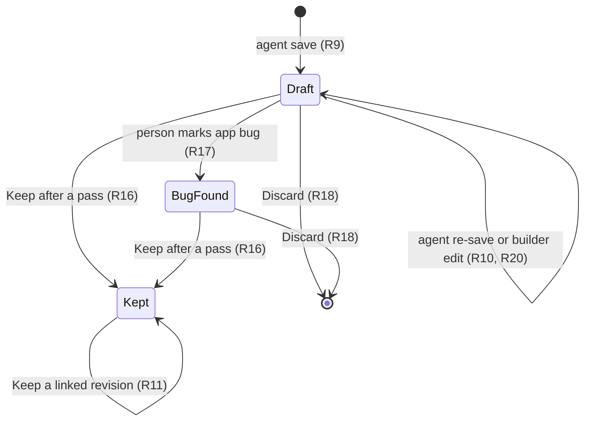
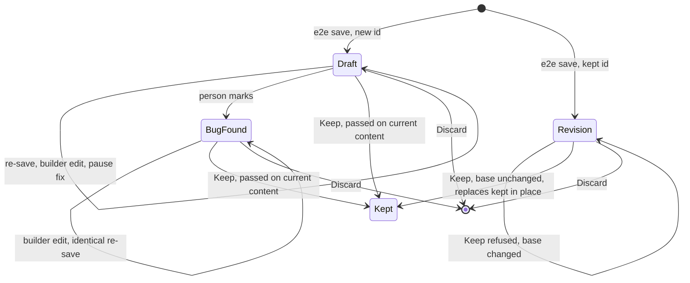
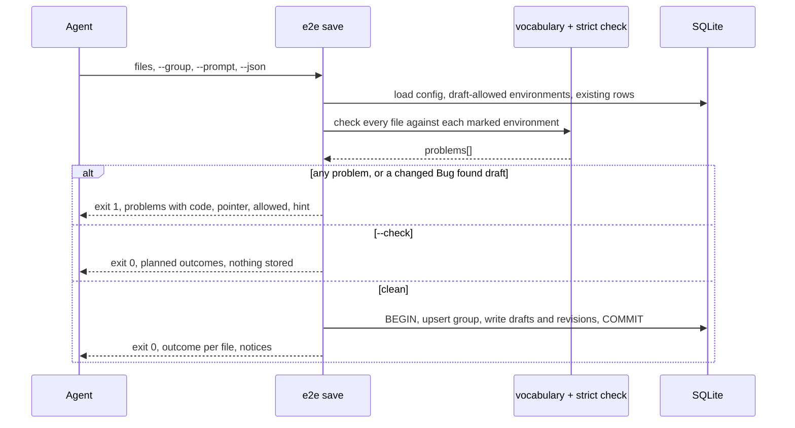
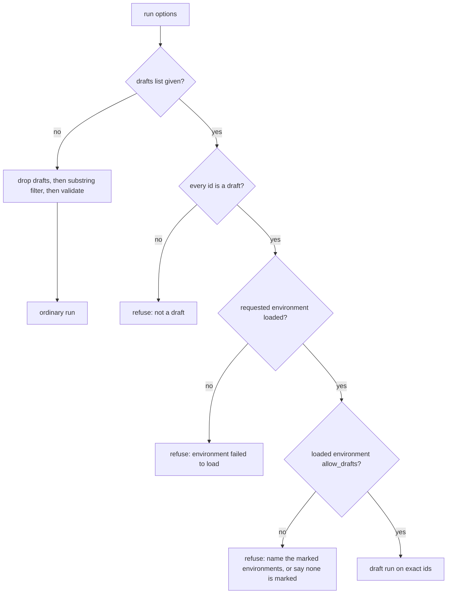

# Agent-Authored Scenarios - Plan

## Goal Capsule

- **Objective:** A person can ask a coding agent working in their app's repo to "test all the features", then run what the agent produced from the e2e-orchestrator UI and keep the scenarios that hold up, without writing or reading scenario JSON themselves.
- **Means:** A generated agent kit built from one vocabulary source (KTD1, KTD6), a strict `e2e save` command the agent runs on the scenario files it writes (KTD3, KTD4), and a Draft state in the UI with a plain-language readback, Run batch and Keep (KTD7, KTD9).
- **Product authority:** The Product Contract below. A coverage view, a live app probe, agent self-repair, strict repeat verification, MCP or HTTP channels for agents, and starting the agent from the UI are not active scope.
- **Execution profile:** Deep, 8 units in dependency order (U1 to U8). The CLI path (U1 to U6) works and is testable before any UI work.
- **Stop conditions:** Stop and ask when a unit would need a schema v2, a change to the builder's own save behavior (R12), or a way for the CLI to set the draft mark (KTD10).
- **Who finishes:** `ce-work` on a feature branch cut from `development`, merged locally fast-forward only, unpushed, per `AGENTS.md`.
- **Open blockers:** None.

---

## Product Contract

### Summary

A coding agent in the consumer repo (zomilabu) reads a generated kit that lists the project's real targets, fixtures, actions and rules. It writes scenario files and saves them with one `e2e` command. The command refuses anything invalid, with errors that say how to fix them, and stores valid scenarios as Drafts grouped by the prompt. In the UI the person reads each draft as plain sentences, runs the batch on dev, keeps the drafts that pass, and marks drafts that fail on a real app bug as Bug found.

### Problem Frame

The person has not created scenarios in this tool by any method yet. They use coding agents for their app work and want the agent to be the main author of e2e coverage, with the UI builder as an equal second path.

Today an agent cannot do this reliably. The vocabulary it would learn from is spread across the JSON Schema, the step checker, the driver code and prose docs, and these already disagree: `checkSteps` rejects `run`, `flow` and `params` while `schema/v1/scenario.schema.json` still declares them. Valid target and fixture names exist only in the project config. Errors are plain strings with no fix. `POST /api/scenarios` saves before it checks and answers `ok: true` even for an invalid scenario. `e2e import` checks only the JSON Schema, not the step rules. Nothing marks a scenario as written by an agent, so agent output would look the same as a vetted test and could run against any environment `E2E_ENV` names, including one that reports to production.

The intended prompt is broad ("use e2e testing to test all the features"), so one prompt yields many scenarios. Reviewing them one by one as JSON does not scale. The person wants the run itself to be the review.

### Key Decisions

- **The run is the review.** Drafts are run as a batch first; the person skims passing ones and inspects or re-prompts on failures. Governs R15, R16. (session-settled: user-directed — chosen over reading every readback before running, trusting agent output with no gate, and approving per feature: running is how a batch of ~30 is actually vetted)
- **A draft needs a pass, then an explicit Keep.** Governs R16, R19. (session-settled: user-approved — chosen over automatic promotion on a clean pass and Keep without a pass: green keeps meaning "tests the person accepted")
- **A draft that fails on a real app bug stays a draft, marked Bug found, and the agent cannot rewrite it.** Governs R17. (session-settled: user-directed — chosen over sending it back to the agent, which may loosen the check until it passes)
- **The agent's channel is files plus one CLI command.** Governs R6, R7. (session-settled: user-approved — chosen over an HTTP API on the running UI and an MCP server: works with any agent and needs no server or MCP setup)
- **Drafts are a status on ordinary scenarios, grouped by the prompt that produced them.** Governs R9, R13, R15. (session-settled: user-approved — chosen over a separate batch entity with a coverage view and over keeping drafts as files outside SQLite: existing run, report and Pause on Failure tooling works on drafts unchanged)
- **The UI builder stays an equal authoring path.** Governs R12, R20. (session-settled: user-directed — chosen over limiting the builder to review and small tweaks)
- **The vocabulary has one source,** so the schema, checker, drivers and kit cannot disagree again. Governs R1, R2, R3.
- **A save is all or nothing,** so a batch never lands half-written. Governs R7.

### Actors

- A1. Person: owns the consumer project, prompts the agent, reviews and runs drafts in the UI, decides what to keep.
- A2. Coding agent: Claude Code, Codex or Cursor working in the consumer repo with read access to its source; reads the kit, writes scenario files, runs the save command.
- A3. e2e-orchestrator: generates the kit, validates and stores drafts, runs them, enforces the draft and environment rules.

### Requirements

**Vocabulary and agent kit**

- R1. One source defines every action, its aliases and fields per driver, assertion operators, placeholder namespaces and removed fields; the schema, step checker, driver action handling and docs agree with it.
- R2. The removed fields `run`, `flow` and `params` are rejected by every check, including the schema.
- R3. An unknown or misspelled action, target, fixture or env variable name is reported when the scenario is checked, before any run.
- R4. An `e2e` command writes an agent kit into the consumer project that lists the project's real targets, fixtures and env variable names, the actions and fields per driver, the existing presets and step groups, two or three example scenarios, the rules (targets by name, no raw URLs, ports or serials, never production), and how to check and save.
- R5. Running the kit command again brings the kit up to date with the current config and vocabulary, and touches only content the kit owns.

**Strict save for agents**

- R6. The agent saves by writing scenario JSON files and running one `e2e` command on them, which also has a check-only mode that stores nothing; neither needs the UI to be running.
- R7. The command applies every check (schema, step rules, target and fixture names, each `${ctx.*}` extracted before it is used) and stores nothing when any file fails.
- R8. Each problem is reported with its file, step location, a stable code, the allowed values when there is a fixed set, and a fix hint, in a form an agent can parse and a person can read.
- R9. Every scenario saved through the command is a Draft that records the prompt it came from and which agent wrote it.
- R10. Saving a file for an existing draft updates that draft instead of adding a second one.
- R11. Saving a file that targets a kept scenario creates a draft revision linked to it; the kept scenario keeps running unchanged until the revision is kept, and keeping it replaces the kept content in place.
- R12. The builder's own save behavior does not change.

**Drafts in the UI**

- R13. The scenario list shows drafts apart from kept scenarios, grouped by prompt, each with its status (Draft or Bug found) and whether its current content has passed.
- R14. Each draft shows a readback: its steps as plain sentences generated from the steps themselves, next to the prompt, with the targets and fixtures it uses; the readback shows no runtime internals.
- R15. Run batch runs every draft in a prompt group in one run, with Pause on Failure available, using the existing run tooling and reports.
- R16. Keep is available only for a draft whose current content passed a run; Keep all passing keeps every such draft in a group at once.
- R17. The person can mark a failing draft Bug found; an agent save that would change a Bug found draft is refused with an error saying why.
- R18. The person can discard a draft or a whole prompt group.
- R19. Any change to a draft's steps clears its pass, so it needs a new pass before Keep.
- R20. A draft edited in the builder stays a draft; a scenario created in the builder is kept from the start.

**Run safety**

- R21. Ordinary runs (run all, a scenario filter, the CLI `run`) leave drafts out, and drafts never affect an ordinary run's outcome.
- R22. An environment can be marked as allowed for drafts; a run that includes drafts is refused on any environment without that mark, whatever `E2E_ENV` says, and no environment carries the mark until the person sets it.

### Key Flows

- F1. Prompt to kept scenarios
  - **Trigger:** The person asks the agent in the zomilabu repo to test all the features.
  - **Actors:** A1, A2, A3
  - **Steps:** The agent reads the kit and the app source, writes scenario files, runs the check-only mode and fixes reported problems, then saves. Drafts appear in the UI under that prompt. The person reads the readbacks, picks a draft-allowed environment and runs the batch. The person uses Keep all passing, then looks at the failures.
  - **Outcome:** Passing drafts are kept scenarios; failing ones stay drafts for the next step.
  - **Covered by:** R4, R6, R7, R8, R9, R13, R14, R15, R16, R22
- F2. Failure handling
  - **Trigger:** A draft fails in the batch run.
  - **Actors:** A1, A2
  - **Steps:** The person opens the failure in Reports. If the test is wrong, they fix it in the builder or re-prompt the agent, which re-saves the draft, and run it again. If the app is wrong, they mark the draft Bug found.
  - **Outcome:** The draft passes and is kept, or waits as Bug found until the app is fixed.
  - **Covered by:** R10, R16, R17, R19, R20
- F3. Agent revises a kept scenario
  - **Trigger:** The agent saves a file for a scenario that is already kept.
  - **Actors:** A2, A1
  - **Steps:** A linked draft revision appears; ordinary runs keep using the kept version. The person runs the revision and keeps it once it passes.
  - **Outcome:** The kept scenario's content is replaced in place.
  - **Covered by:** R11, R16, R21

### Acceptance Examples

- AE1. **Covers R7.** Given 30 files where one uses an unknown target, when the agent saves, then nothing is stored and the error names that file, the step and the configured target names.
- AE2. **Covers R16, R19.** Given a draft that passed, when the person edits one step in the builder, then Keep is unavailable until it passes again.
- AE3. **Covers R17.** Given a Bug found draft, when the agent saves a changed version of it, then the save is refused and the draft is unchanged.
- AE4. **Covers R21.** Given kept scenarios and drafts, when the person runs all scenarios from the UI or `e2e run`, then only kept scenarios run.
- AE5. **Covers R22.** Given `E2E_ENV` set to an environment without the draft mark, when a run including drafts starts, then it is refused and names the environments that allow drafts.
- AE6. **Covers R11.** Given a kept login scenario, when the agent saves a revision, then the next ordinary run uses the kept version and the revision waits as a linked draft.

### Success Criteria

- A fresh agent session in zomilabu, given only the kit, reaches a clean save of a multi-scenario batch by fixing reported errors, with no help from the person.
- The person goes from a saved batch to a kept set using only the UI, without opening any scenario JSON.

### Scope Boundaries

Deferred for later:

- A coverage view of features found against scenarios written (the stored prompt makes it possible later).
- A live probe of the running app for selectors, texts and API shapes.
- Agent self-repair of failed drafts, and rules on which failure labels it may repair.
- Requiring repeated strict passes before Keep.
- MCP or HTTP channels for agents, and starting the agent from the UI.
- A diff view between a kept scenario and its draft revision.
- Using the vocabulary source to drive the builder's own action and field pickers.

### Dependencies / Assumptions

- The agent finds features and chooses selectors by reading zomilabu's source; with no live probe in this work, some first runs will fail on selectors.
- The zomilabu dev build is an acceptable target for draft runs (its analytics are filtered from production).
- Domain docs `docs/domain/scenarios.md`, `docs/domain/runs.md` and `docs/domain/environments.md` change in the same commits as the behavior.

### Outstanding Questions

Resolved in planning:

- Schema v2 for removed fields: not needed; v1 changes in place (KTD2).
- Kit location and form: a marker block in the root `AGENTS.md` and `CLAUDE.md`, plus a kit file and a vocabulary file under `.e2e/agent/` (KTD6).
- Readback phrasing: one sentence template per vocabulary action, with a generic fallback (KTD9).
- Prompt group identity: an agent-chosen `--group` slug, echoed back on every save (KTD4).

### Sources / Research

- `src/server/routes/scenarios.ts:57-63`: saves before it reports validity.
- `src/scenario.ts:24-27`, `:62` and `schema/v1/scenario.schema.json:92-99`: removed fields rejected by the checker, still declared by the schema.
- `src/import.ts:18-20`, `:46-47`, `:63-68` and `src/cli.ts:153`: import is "file wins", matches id-less steps, refuses schema-invalid files, and does not run `checkSteps`.
- `src/drivers/web.ts:387-388`, `src/drivers/mobile.ts:166-167`: unknown actions thrown in the drivers.
- `src/db/connection.ts:38-50`, `:102-111`: no draft, source or prompt column on scenarios; no agent flag on environments.
- `src/config.ts:159`: environment chosen from `E2E_ENV`.
- `src/run-result.ts:8`, `:34-36` and `docs/domain/runs.md:224`: a run with a scenario fixed during a pause ends `FAILED`, so green means nobody stepped in.
- `src/server/routes/runs.ts:66-76`: UI runs support `headless` and Pause on Failure.
- `src/init.ts:43-96`: `e2e init` writes the database and one starter scenario, no agent docs.
- `docs/ideation/2026-10-11-agent-authored-scenarios-ideation.html`: ideas 1-3, with the evidence and the external prior art (Playwright Test Agents, Maestro MCP, QA Wolf review model).

---

## Planning Contract

**Product Contract preservation:** Product Contract unchanged. Only the Outstanding Questions list was rewritten to point at the KTDs that resolve it.

### Key Technical Decisions

- KTD1. **One vocabulary module, `src/vocabulary.ts`, owns every action, alias, field set, operator, placeholder namespace, removed field and error code.** `checkSteps`, the kit, the readback and the tests read it. The drivers keep their `switch` statements, and a test asserts that every vocabulary action reaches a driver case. Generating the JSON Schema from the module is not done: the schema stays hand-written and a test asserts it agrees with the module. Pulled-in fixes, all from research:
  - The mobile driver accepts the single-`action` step form, as web already does. The checker accepts it today and the driver throws (`src/drivers/mobile.ts:42-46`).
  - StepAction `status` and `exit_code` stay accepted and are marked in the vocabulary as having no effect. The builder writes them (`ui/src/views/scenario-builder/stepDefaults.ts:28-35`), but no driver reads them; assertions read only step-level `assert` (`src/assertions.ts:36-42`). The kit does not teach them. (session-settled: user-directed — chosen over removing them, which would invalidate builder-saved scenarios, and over making the drivers read them: the builder fix is separate work)
  - http action names (`http_get`, `http_post`, `http_put`, `http_patch`, `http_delete`) and the shell name (`shell`) are enforced when an action is present. zomilabu's 83 api steps carry no action, so nothing breaks.
  (session-settled: user-approved — chosen over keeping the five copies and patching each: they already disagree, and the kit would add a sixth)
- KTD2. **Schema v1 changes in place, not a v2.** `schema/README.md` calls removing or tightening a breaking change. The only removals are `run`, `flow` and `params`, which no driver runs and which already fail `checkSteps`, so no file that runs today stops passing. `schema/README.md` records this exception and its reason. (session-settled: user-approved — chosen over a v2 folder loaded side by side: it would protect zero working files)
- KTD3. **Two check levels share one problem type.** The base level (schema, targets, fixtures, step fields, action names, removed fields) runs everywhere `checkSteps` runs today. The strict level adds `${ctx.*}` produced-before-use, `${env.*}` names from configured `env_vars` only, and refusal of absolute `http(s)://` URLs. Only `e2e save` runs the strict level, because process env vars and absolute URLs are legal in kept scenarios today. Each problem carries `{ file, pointer, stepIndex, stepName, code, message, value, allowed, hint }`. A string formatter keeps the existing `errors: string[]` callers unchanged. R3's env-name rule is met at `e2e save`, the check every agent draft passes before any run. Base checks keep accepting process env names, because kept scenarios use them today.
- KTD4. **`e2e save` is the agent's only write path.** Contract:
  - Input: file paths or folders as positionals; with none, `.e2e/drafts/<group>/*.json`. Scenario id is the file basename, as in `src/import.ts`.
  - Flags: `--group <slug>` (required), `--prompt <text>` (required when the group is new), `--agent <name>`, `--check` (store nothing, the same meaning `--check` has for `export`), `--json`.
  - Output: human text by default; `--json` prints one document `{ ok, mode, project, dbPath, checkedEnvironments, group, results, problems, notices }`. On failure `results` is empty.
  - Exit codes: 0 stored or clean, 1 problems and nothing stored, 2 usage, 3 project or database error.
  - The command walks up from the current folder to the nearest `.e2e/`. Other commands keep today's lookup.
  - Per-file outcome: `created`, `updated`, `unchanged`, `revision-of <kept id>`, `matches-kept`.
  (session-settled: user-approved — chosen over an HTTP API on the running UI and an MCP server: works with any agent and needs no server)
- KTD5. **A save checks every file first, then writes all of them inside one SQLite transaction.** No code in the repo uses transactions yet. `node:sqlite` supports `BEGIN`/`COMMIT`/`ROLLBACK`. Incoming step and action ids are dropped on every draft save, so copied exports and presets cannot collide on the global `scenario_steps.id` key. `openDatabase` sets a busy timeout of about 5 seconds, so a save transaction and a running batch's `scenario_runs` writes wait for each other. Without it the runner's best-effort history write fails silently and the pass is lost (`src/scenario-run.ts:85-112`).
- KTD6. **The kit is three generated files plus a marker block.** `e2e kit` writes `.e2e/agent/kit.md` and `.e2e/agent/vocabulary.json`, and rewrites only the text between `<!-- e2e-kit:start -->` and `<!-- e2e-kit:end -->` in whichever of the root `AGENTS.md` and `CLAUDE.md` exist. It never creates either file. Files are resolved by real path, de-duplicated and written in place, so a `CLAUDE.md` symlinked to `AGENTS.md` (as in zomilabu) gets one block and stays a symlink. The block names the kit path, the save recipe and the person-only actions. Reason: `.e2e` is gitignored in zomilabu (`.gitignore:41`), and agents skip gitignored paths. The kit lists env var names, never values. (session-settled: user-approved — chosen over a kit only under `.e2e/` and over a skill file: every agent reads the root instruction files)
- KTD7. **Draft state lives in columns on `scenarios` that `saveScenario` never writes.** New columns: `draft_state` (NULL for kept, `draft`, `bug_found`), `draft_group`, `revision_of`, `base_fingerprint`. A new `draft_groups` table holds `key`, `prompt`, `agent` and `created_at`. `saveScenario`'s `ON CONFLICT` list leaves them out, so builder saves and Pause on Failure fixes keep a draft a draft (R12, R20). A revision is its own row with the id `<kept id>@draft` and `revision_of` set. One row per id: a re-save from another group moves the draft to that group. (session-settled: user-approved — chosen over a separate batch entity and over files outside SQLite: existing run, report and Pause on Failure tooling works on drafts unchanged)
- KTD8. **"Passed on current content" is derived, never stored.** It is true when the latest run that ran this id on its current fingerprint finished every iteration `PASSED`. `FIXED` does not count. Recovered steps count, as they do for a run's `PASSED`. The query sits next to `changedSinceLastPass` in `src/db/scenario-runs.ts`. Any content change gives a new fingerprint, which delivers R19 with no clearing logic.
- KTD9. **The readback is computed in core (`src/readback.ts`) and sent by the drafts API.** The UI cannot import `src/`. Each vocabulary action has one sentence template. An action without one falls back to "`<action>` on `<target>`". The readback also lists the risky parts verbatim: shell commands, `read_only`, `vars` and any absolute URL left by a builder edit.
- KTD10. **The draft mark is an `allow_drafts` column on `environments`, set only from the UI.** It defaults to 0 and has its own setter, so `saveEnvironment`'s form rewrite keeps it. The run gate checks the environment the run actually loaded, inside `run()` in `src/runner.ts`, so the CLI and the server share it. `POST /api/run` with `drafts` runs the same checks before it sets `state.activeRun` and responds: the environment loads, every id is a draft, and `allow_drafts` is set. A failure returns 409 with the message. Today the route answers 200 before the run starts, so a refusal inside `run()` would show only as a failed run. The trust model is cooperative: the gate stops mistakes, not an agent that edits SQLite.
- KTD11. **Runs select drafts by exact id, never by substring.** `RunOptions` gains `drafts?: string[]`. With it, the run loads exactly those ids, all of which must be drafts. Without it, `loadScenarios` drops drafts before the substring filter and before validation, so one invalid draft cannot fail an ordinary run (R21). Runs never mix drafts and kept scenarios. Every UI caller that can start a run on a draft sends `drafts`: Run batch, and Reports' Re-run with Pause on Failure.
- KTD12. **Target checks use every draft-allowed environment.** A target must exist in each marked environment, and the problem names the one that lacks it. With none marked, the check uses the default environment and adds the notice `no-draft-environment`. `E2E_ENV` and `--env` are ignored by `e2e save`.
- KTD13. **Import and export leave drafts alone.** `e2e import` runs `checkSteps` and skips any file whose id is a draft or revision, with a reason. `e2e export` and `export --check` write kept scenarios only. The first-open seed never reads `.e2e/drafts/`, because it reads only the scenarios folder.
- KTD14. **Keep refuses unsafe states.** Keep of a revision compares `base_fingerprint` with the kept scenario's current fingerprint and refuses on mismatch or a missing kept scenario. Keep all passing skips such revisions and names them. Keeping a revision replaces the kept content with new step ids, so step history restarts for those steps. A refused revision's exit is Discard plus an agent re-save, which records the kept scenario's current fingerprint as the new `base_fingerprint`. The refusal message names that path. Discard of a draft in `state.activeRun` returns 409.

### High-Level Technical Design

Draft lifecycle, including revisions and the stale-base refusal (KTD7, KTD14):

`e2e save` sequence (KTD4, KTD5, KTD12):

Run selection gate (KTD10, KTD11):

### Assumptions

- `node:sqlite` transactions behave as documented when the UI process holds the same database open. A locked database gives exit 3 with a hint.
- A revision id of the form `<kept id>@draft` works wherever scenario ids are used once `DELETE /api/scenarios/:id` decodes its id (U7). Drafts are not exported, so it never becomes a file name.
- The builder writes per-action `status` and `exit_code` (`ui/src/views/scenario-builder/stepDefaults.ts:28-35`, `HttpShellActionInputs.tsx`), and no driver reads them. See KTD1.

### Sequencing

U1 and U2 change only checking. U3 adds storage but no writer. U4 makes ordinary runs safe before any draft can exist. U5 is the first writer of drafts. U6 to U8 add the kit, the review API and the UI.

---

## Implementation Units

### U1. Vocabulary module and structured problems

- **Goal:** One module defines the scenario vocabulary, and the checker, schema and drivers agree with it.
- **Requirements:** R1, R2, R3.
- **Dependencies:** None.
- **Files:**
  - Create `src/vocabulary.ts`, `src/problems.ts`, `test/vocabulary.test.ts`.
  - Modify `src/scenario.ts`, `src/schema.ts`, `schema/v1/scenario.schema.json`, `schema/README.md`, `src/drivers/mobile.ts`, `test/scenario.test.ts`, `test/mobile-driver.test.ts`, `docs/domain/scenarios.md`.
- **Approach:**
  1. Move `DRIVER_FIELDS`, `REMOVED_FIELDS`, `NEEDS` and `COMMON` from `src/scenario.ts` into `src/vocabulary.ts`. Add per-driver actions with aliases and fields, `json_match` operators, placeholder namespaces and the error-code catalogue with hints (KTD1).
  2. `checkSteps` returns problems of the KTD3 shape. A formatter gives today's strings to `loadScenarios`, the scenario routes and `ScenarioItem.errors`.
  3. Add base-level checks inside `actions[]`: action name per driver, matched case-insensitively as the drivers do, and fields per action.
  4. Edit the schema in place (KTD2): drop `run`, `flow` and `params` from `Step`. Record the exception in `schema/README.md` and remove its stale flow text.
  5. Make the mobile driver accept the single-`action` form.
- **Patterns to follow:** The driver `switch` with alias fall-through (`src/drivers/web.ts:91-389`). `describeErrors` in `src/schema.ts`.
- **Test scenarios:**
  - Every vocabulary action and alias reaches a driver case without the unknown-action error, through the fakes in `test/web-driver.test.ts` and `test/fake-adb.ts`.
  - Every `case` label in the web and mobile driver switches is a vocabulary action or alias.
  - A mobile action `tapOn` passes the check.
  - A web step with action `clik` gives `unknown-action` with `allowed` listing the web actions.
  - An http action `http_fetch` gives `unknown-action`. An http step with no action stays valid.
  - A step with `run` fails both the schema and `checkSteps` with `field-removed`.
  - A builder-shaped http action with `status: 200` and a shell action with `exit_code: 0` still pass the check.
  - A mobile step with a single `action: "tap"` passes the check and runs through the fake device.
  - The schema's `StepAction` properties equal the union of vocabulary action fields, including the no-effect `status` and `exit_code`.
  - `loadScenarios` error text for an unknown target is unchanged.
- **Verification:** `pnpm run check` passes and every existing scenario test passes unchanged.

### U2. Strict check level and stricter import

- **Goal:** The strict level catches agent mistakes before storage, and `e2e import` is no longer weaker than `e2e save`.
- **Requirements:** R3, R7, R8.
- **Dependencies:** U1.
- **Files:**
  - Create `src/strict-check.ts`, `test/strict-check.test.ts`.
  - Modify `src/import.ts`, `test/import.test.ts`, `docs/domain/scenarios.md`.
- **Approach:**
  1. Implement the strict rules from KTD3. `ctx-produced-later` and `ctx-not-produced` are separate codes, since their fixes differ. Sources are the scenario's `vars` and earlier `extract`.
  2. Compare `${env.*}` names with the `env_vars` keys of the checked environments, not `config.env`, which merges the process env (`src/config.ts:205-207`).
  3. Check targets against each environment chosen by KTD12.
  4. `importFromJson` runs `checkSteps` and lists failures as invalid (KTD13).
- **Patterns to follow:** The `PLACEHOLDER` regex in `src/context.ts`. `getPlatformsForEnv` in `src/config.ts`.
- **Test scenarios:**
  - `${ctx.token}` used in step 2 and extracted in step 4 gives `ctx-produced-later` naming step 4.
  - `${ctx.token}` never extracted and not in `vars` gives `ctx-not-produced`.
  - `${ctx.user}` defined in `vars` passes.
  - `${env.API_KEY}` set only in the process env gives `unknown-env-var` with `allowed` listing the configured names.
  - An http `url` of `https://example.com/x` gives `raw-url`. A relative `/x` passes.
  - A target present in one marked environment and absent in another gives `unknown-target` naming the second environment.
  - With no environment marked, the default environment's targets are used.
  - `e2e import` of a file with an unknown target lists it as invalid and saves nothing for it.
- **Verification:** Each strict code has a fixture that triggers it, with the expected `pointer` and a non-empty `hint`.

### U3. Draft storage and the pass query

- **Goal:** SQLite can hold drafts, revisions, groups and the draft mark, and can answer "passed on current content".
- **Requirements:** R9, R10, R11, R16, R17, R19, R22.
- **Dependencies:** U1.
- **Files:**
  - Create `src/db/drafts.ts`, `test/drafts-db.test.ts`.
  - Modify `src/db/connection.ts`, `src/db/scenarios.ts`, `src/db/scenario-runs.ts`, `src/db/environments.ts`, `src/config.ts`, `src/export.ts`, `src/import.ts`, `test/scenario-runs.test.ts`, `test/export.test.ts`, `test/import.test.ts`, `docs/domain/scenarios.md`, `docs/domain/runs.md`, `docs/domain/environments.md`.
- **Approach:**
  1. Add the KTD7 columns and the `draft_groups` table in the `CREATE TABLE` block, with `addMissingColumn` lines for existing databases. Add `allow_drafts INTEGER DEFAULT 0` to `environments` (KTD10).
  2. `src/db/drafts.ts` holds the draft-state reads and writes: get draft info, upsert group, write a draft or revision, keep, mark Bug found, discard draft, discard group. It never touches content columns except through `saveScenario`.
  3. `getScenarios` gains a way to exclude drafts. Export uses it (KTD13).
  4. Add the KTD8 pass query to `src/db/scenario-runs.ts`.
  5. Read `allow_drafts` into `EnvironmentConfig`. Add a separate setter that `saveEnvironment` does not overwrite.
  6. Import skips ids that are drafts or revisions, with a reason.
  7. `openDatabase` passes the busy timeout to `DatabaseSync` (KTD5).
- **Patterns to follow:** The `read_only` column (`src/db/scenarios.ts`). `changedSinceLastPass` in `src/db/scenario-runs.ts`. `setActiveEnvironment` in `src/db/environments.ts`.
- **Test scenarios:**
  - A builder `saveScenario` on a draft leaves `draft_state`, `draft_group` and `revision_of` unchanged.
  - `replaceScenarioStep` on a draft keeps it a draft.
  - The pass query is true after a `PASSED` run on the current fingerprint and false after a step edit.
  - A `FIXED` scenario run does not count as a pass.
  - A run with `repeat` 2 where iteration 2 failed does not count.
  - A later failed run on the same fingerprint clears the pass.
  - `saveEnvironment` from the form keeps `allow_drafts` set.
  - A new environment has `allow_drafts` 0.
  - Export writes no file for a draft or revision. `export --check` does not report them as missing.
  - Import skips a scenarios-folder file whose id is a draft and names the reason.
  - Opening an existing database adds the new columns without losing rows.
  - A `scenario_runs` write made while another connection holds a write transaction lands after the transaction commits.
- **Verification:** New DB tests live in `test/drafts-db.test.ts`, since `test/db.test.ts` is over budget.

### U4. Run safety

- **Goal:** Ordinary runs never see drafts, and draft runs happen only by exact id on a marked environment.
- **Requirements:** R15, R21, R22. Covers AE4, AE5.
- **Dependencies:** U3.
- **Files:**
  - Modify `src/scenario.ts`, `src/runner.ts`, `src/server/routes/runs.ts`, `src/cli.ts`, `test/runner.test.ts`, `test/server.test.ts`, `docs/domain/runs.md`, `docs/domain/environments.md`.
- **Approach:**
  1. `loadScenarios` drops drafts before filtering and validating, and loads exact ids when given `drafts` (KTD11).
  2. `run()` refuses a draft run unless `config.environments[config.activeEnvironment].allow_drafts` is set. The message names the marked environments, or says none is marked and where to set it (KTD10).
  3. `POST /api/run` passes `drafts` through and runs the KTD10 checks before it responds.
  4. `e2e run -s <text>` that matches only drafts says so and exits 1, instead of "No scenarios matching".
- **Patterns to follow:** `RunOptions` construction in `src/server/routes/runs.ts:56-90`.
- **Test scenarios:**
  - Covers AE4. With one kept and one draft scenario, `e2e run` and `POST /api/run` with no filter run only the kept one.
  - `-s login` with a kept `login-admin` and a draft `login` runs only `login-admin`.
  - An invalid draft does not stop an ordinary run from starting.
  - Covers AE5. A draft run with `E2E_ENV` on an unmarked environment is refused and names the marked ones.
  - With no environment marked, a draft run is refused with the "none is marked" message.
  - A draft run whose `environment` fails to load is refused, not run on the active environment.
  - `POST /api/run` with `drafts` on an unmarked environment returns 409 with the refusal message and leaves `state.activeRun` empty.
  - `drafts` containing a kept id is refused.
  - `e2e run -s <draft id>` prints the skipped-draft message and exits 1.
- **Verification:** The gate is covered from both the CLI and the server path.

### U5. The `e2e save` command

- **Goal:** An agent stores a batch of scenario files as drafts in one call, or learns exactly what to fix.
- **Requirements:** R6, R7, R8, R9, R10, R11, R17. Covers F1, F3, AE1, AE3, AE6.
- **Dependencies:** U2, U3, U4.
- **Files:**
  - Create `src/agent-save.ts`, `test/agent-save.test.ts`.
  - Modify `src/cli.ts`, `src/db/paths.ts`, `docs/domain/scenarios.md`.
- **Approach:**
  1. Wire `save` into the `src/cli.ts` command list, `HELP` and `parseArgs`, keeping the logic in `src/agent-save.ts`.
  2. Find the project by walking up to `.e2e/` (KTD4). Print `dbPath` and the group in every output.
  3. Read and check every file at the strict level against the KTD12 environments.
  4. Classify each file: new, existing draft, Bug found, kept id, or duplicate basename in the batch. A changed Bug found draft gives `draft-bug-found` with a hint to drop that file. Identical content is `unchanged` (KTD7, KTD14).
  5. Without problems and without `--check`, write everything in one transaction (KTD5).
  6. Render human text or the `--json` document. Map errors to exit codes 0 to 3.
- **Patterns to follow:** `src/import.ts` for file reading and `sameScenario`. The `src/cli.ts` output style with `color` and `relative` paths.
- **Test scenarios:**
  - Covers AE1. 30 files, one with an unknown target: exit 1, nothing stored, and the problem names the file, the step and the configured targets. The database stays byte-identical.
  - 3 valid files with a new group and prompt: exit 0, 3 `created` drafts, and the group stores prompt and agent.
  - Re-saving the same folder gives `unchanged` for each file and keeps an earlier pass.
  - Saving one changed file updates that draft and clears its pass.
  - Covers AE6. A file named after a kept id gives `revision-of <id>`, and the kept scenario is unchanged.
  - A file identical to its kept scenario gives `matches-kept` and no revision.
  - Covers AE3. A batch with a changed Bug found draft gives `draft-bug-found`, and nothing in the batch is stored.
  - An unchanged Bug found file in the batch is `unchanged`, and the rest are saved.
  - `--check` with valid files exits 0 and stores nothing.
  - A missing `--group` exits 2. A new group without `--prompt` exits 2.
  - A missing database exits 3 with a hint.
  - A file with step ids copied from an export saves with new ids.
  - Two files with the same basename in one batch give `duplicate-id`.
  - With no environment marked, the save succeeds and carries `no-draft-environment`.
  - Run from a subfolder of the project, the command finds `.e2e/`.
  - `--json` stdout parses as one document with no color codes, for success and failure.
  - Every emitted code exists in the vocabulary catalogue.
- **Verification:** The F1 dry run's deterministic part passes as a CLI test: planted mistakes get fixed from the JSON output alone.

### U6. The agent kit

- **Goal:** A fresh agent finds the project's real names and the save recipe.
- **Requirements:** R4, R5.
- **Dependencies:** U1, U5.
- **Files:**
  - Create `src/agent-kit.ts`, `test/agent-kit.test.ts`.
  - Modify `src/cli.ts`, `docs/domain/scenarios.md`.
- **Approach:**
  1. `e2e kit` writes the KTD6 files. The kit lists, per marked environment (or the default), the targets with their drivers, fixtures, env var names, presets and step groups. It also lists the vocabulary, the error codes with hints, two or three example scenarios built from the project's own config, the rules (targets by name, no raw URLs, ports or serials, never production), the `.e2e/drafts/<group>/` folder, and the save recipe with `--json`.
  2. It names the person-only actions: Keep, Keep all passing, Bug found, Discard, the draft mark, Run batch. It also names the routes agents must not use: `POST /api/scenarios`, `e2e import`, and SQLite directly.
  3. Presets and step groups are described as copy-inline, since no schema field references them.
- **Patterns to follow:** `initProject` in `src/init.ts` for project file writes. `scripts/check-boundary.mjs` constrains the static templates.
- **Test scenarios:**
  - The kit lists the configured target names and fixture names of a seeded temp project.
  - A config with secret env var values produces a kit that contains none of the values.
  - A second `e2e kit` run after adding a target updates the kit and leaves `AGENTS.md` text outside the markers byte-identical.
  - With no `AGENTS.md` or `CLAUDE.md` at the root, the kit writes neither file and says so.
  - An `AGENTS.md` without markers gets the block appended once. A second run does not duplicate it.
  - `vocabulary.json` lists every action and error code in `src/vocabulary.ts`.
  - With `CLAUDE.md` symlinked to `AGENTS.md`, the kit writes one block and the symlink stays in place.
- **Verification:** The static kit text passes `scripts/check-boundary.mjs`.

### U7. Drafts API and readback

- **Goal:** The server gives the UI grouped drafts with readbacks and pass state, and carries out the person's actions.
- **Requirements:** R13, R14, R16, R17, R18. Covers AE2.
- **Dependencies:** U3, U4.
- **Files:**
  - Create `src/readback.ts`, `src/server/routes/drafts.ts`, `test/readback.test.ts`, `test/drafts-routes.test.ts`.
  - Modify `src/server.ts` (route registration only), `src/server/routes/scenarios.ts`, `src/server/routes/environments.ts`, `docs/domain/scenarios.md`.
- **Approach:**
  1. `src/readback.ts` turns steps into sentences from the vocabulary templates (KTD9).
  2. `GET /api/drafts` returns groups with prompt, agent, and each draft's state, readback, targets, fixtures, pass state, last run status and `revision_of`.
  3. Endpoints: Keep one, Keep all passing in a group, mark Bug found, discard one, discard a group. Keep refusals and the discard 409 follow KTD14.
  4. `GET /api/scenarios` marks drafts with a draft summary outside `raw`, so the builder never posts draft fields back.
  5. Add the draft-mark setter route to `src/server/routes/environments.ts`.
  6. `DELETE /api/scenarios/:id` decodes its id, as the step-history route does.
  7. Readback text follows `DESIGN.md` rule 9: `vars` and `read_only` appear as plain phrases (for example "Starts with values: ...", "Reuses the setup (read-only)"). Shell commands and absolute URLs are the only verbatim raw content.
- **Patterns to follow:** The `{ match, handle }` route modules. New `/api/scenarios/...` paths go before the broad DELETE matcher in `src/server/routes/scenarios.ts`.
- **Test scenarios:**
  - Every vocabulary action produces a readback sentence or the defined fallback.
  - A shell step's readback shows its command verbatim.
  - Keep on a draft with a pass on current content makes it kept.
  - Covers AE2. After a builder edit of one step, Keep on that draft is refused until a new pass.
  - Keep all passing keeps the passing drafts and leaves the failing ones as drafts.
  - Keep of a revision replaces the kept scenario's content and removes the revision row.
  - Keep of a revision whose kept scenario changed since the save is refused. Keep all passing skips it and names it.
  - Discard of a draft in the active run returns 409.
  - Discard of a group removes its drafts and revisions and leaves the kept scenarios.
  - Marking Bug found on a kept scenario is refused.
  - The stale-revision refusal message names Discard and re-save as the way out.
  - `DELETE /api/scenarios/login%40draft` deletes the `login@draft` row.
- **Verification:** Route tests run against a seeded temp project through the real server.

### U8. Drafts view in the UI

- **Goal:** The person reviews, runs and keeps drafts using only the UI.
- **Requirements:** R13, R14, R15, R16, R17, R18, R20, R22. Covers F1, F2.
- **Dependencies:** U7.
- **Files:**
  - Create `ui/src/views/drafts/` (parent view, group card, draft row, `useDrafts` hook, `draftsApi.ts`, pure helpers), `test/drafts-helpers.test.ts`, `test/ui/drafts.test.ts`.
  - Modify `ui/src/App.tsx`, `ui/src/components/Header.tsx`, `ui/src/views/runner/RunnerView.tsx`, `ui/src/views/runner/ScenarioExplorer.tsx`, `ui/src/views/config/` (draft-mark toggle), `test/ui/helpers.ts`.
- **Approach:**
  1. Add a Drafts tab: a `drafts` tab type in `ui/src/components/Header.tsx`, URL-synced through `VALID_MAIN_TABS` in `ui/src/App.tsx`. Each prompt group shows its prompt, agent and drafts with state, pass badge and readback. With no drafts, an empty state says how an agent saves them.
  2. Each group card has an environment select listing only environments with the draft mark, defaulting to the active one when it is marked. With none marked, the card shows the refusal copy and a link to the Config view's environments.
  3. Run batch sends the group's ids as `drafts` and the chosen environment, offers Pause on Failure, and switches to the Runner tab as `handleRerunPaused` does. A 409 shows the server's message.
  4. Reports' Re-run with Pause on Failure sends `drafts: [id]` when the scenario is a draft or revision (KTD11).
  5. A revision row reads "Revision of <kept name>". Each row has Edit in Builder, which opens the draft in the builder (R20).
  6. Keep appears only on passing drafts. Keep all passing, Bug found and Discard sit on the row or the group, with a confirm dialog for discards.
  7. Badges are Title Case per `DESIGN.md`: Draft, Bug Found, Passed, Not Yet Passed, and Fixed, Run Again for a `FIXED` draft.
  8. The runner's scenario list hides drafts. `RunnerView.tsx` builds its default selection and select-all from kept scenarios only, and still passes the full list to `buildExecutionTree` and `PausePanel` so a draft batch shows its steps.
  9. The Config view's environment form gets an "Allow draft runs" toggle that calls the U7 setter.
  10. New types and fetchers live in the view folder, since `ui/src/types.ts` and `ui/src/api.ts` are at the budget.
- **Patterns to follow:** `DESIGN.md` for layout, badges, dialogs and copy. Reports' Re-run with Pause on Failure (`handleRerunPaused` in `ui/src/App.tsx`).
- **Test scenarios:**
  - Grouping helper: drafts from two groups sort into two groups, in save order.
  - Smoke: a seeded group shows its prompt and each draft's readback.
  - Smoke: Run batch on an unmarked environment shows the refusal naming where to set the mark.
  - Smoke: after the mark is set and the batch passes, Keep all passing moves the drafts out of the Drafts tab.
  - Smoke: Bug found on a failed draft shows the Bug found badge.
  - Smoke: discarding a group asks for confirmation, then removes the group.
  - Smoke: the runner's scenario list shows no drafts, and select-all runs only kept scenarios.
  - Smoke: an empty Drafts tab shows the empty state.
  - Smoke: a revision row reads "Revision of" its kept scenario.
  - Smoke: re-running a failed draft from Reports runs exactly that draft with Pause on Failure.
- **Verification:** `pnpm run test:ui` passes with the new smoke test.

---

## Scope Boundaries (planning)

Considered and not built:

- Unmarking Bug found. Discard or Keep cover the exits. Revisit if people mark by mistake often.
- A guard against concurrent builder and agent edits of one draft. Last write wins, as in the builder today. Revisit if F2 loses edits in practice.
- Agent-started draft runs (`e2e run --drafts`). They border on self-repair, which is out of scope.
- An `updated_at` refresh of the Drafts view on window focus. A reload shows CLI saves.
- `e2e list --json` for agents to read draft state. No requirement needs it: `e2e save --json` reports every outcome, and the person reads pass state in the UI. Revisit if agents need draft state outside a save.
- Bounding the pass to the draft's lifetime (a `draft_since` column). A pass from a discarded draft or a deleted kept scenario with the same id and the same content is still a real pass on that content. Revisit if Keep is offered on content nobody ran in a batch and that surprises people.
- A summary dialog before Keep all passing. Keep is reversible by deleting the kept scenario, unlike Discard.

### Deferred to Follow-Up Work

- CLI parity for the person-only actions, once the UI path satisfies the person.
- The builder's per-action Expected Status and Expected Exit Code inputs have no effect, because no driver reads them. Fix them by writing step-level `assert` or by having the drivers read them.
- Removing the remaining flow leftovers (`src/flow.ts`, `schema/v1/flow.schema.json`, `src/server/routes/flows.ts`). The kit never mentions flows.

---

## Risks

- **The run gate is cooperative.** An agent can edit SQLite or call `POST /api/config/environment` directly. `docs/domain/environments.md` records this, and the kit names the mark as person-only.
- **Absolute URLs from builder edits.** The strict check only covers agent saves. The readback lists any absolute URL so the person sees it before Run batch.
- **Process env overrides environment values in draft runs.** `loadConfig` merges `process.env` over `env_vars`, so a UI started from a shell that exports production values sends them into a draft run. zomilabu's `dev` environment configures only `APP_ENV` today. `docs/domain/environments.md` records this next to the draft mark.
- **First F1 run against zomilabu** will fail on some selectors, since there is no live probe. That is expected, and F2 handles it.

---

## Verification Contract

| Gate | Command | When |
| --- | --- | --- |
| Format and lint | `pnpm exec biome check --write` | After every edit |
| Types, boundary, size, unit tests | `pnpm run check` | After every unit |
| UI smoke | `pnpm run test:ui` | After U8, and before any push (pre-push hook) |
| F1 dry run | A fresh agent session in zomilabu given only the kit saves a multi-scenario batch with no help | Once, by hand, after U6 |
| F1 review | Saved batch to kept set using only the UI on a zomilabu dev environment | Once, by hand, after U8 |

The two by-hand rows need the person and a running zomilabu dev setup. The zomilabu dev build is an acceptable draft-run target.

---

## Definition of Done

- Every unit's test scenarios exist and pass under `pnpm run check`, and `pnpm run test:ui` passes.
- AE1 to AE6 each have a test that names them.
- `docs/domain/scenarios.md`, `docs/domain/runs.md`, `docs/domain/environments.md` and `schema/README.md` describe the new behavior in the same commit as the code.
- No new file under `src/` or `ui/src/` is over the ~500-line budget.
- The F1 dry run and the F1 review pass by hand, or their failures are written up with cause.
- Code from abandoned approaches is removed from the diff.
