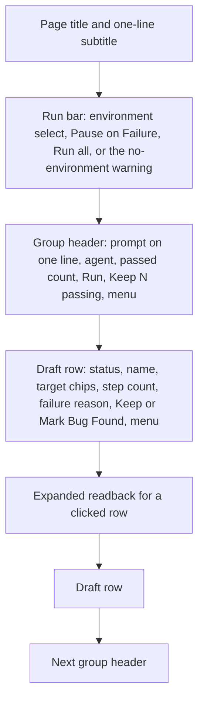
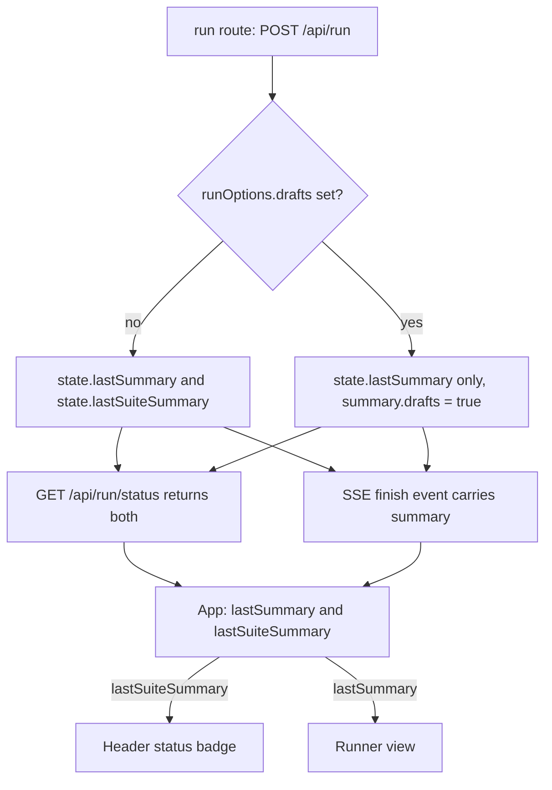

# Drafts Tab Compact List - Plan

## Goal Capsule

- **Objective:** A person who asked a coding agent for scenarios can open the Drafts tab and, within a few seconds, tell which drafts passed, which failed and why, and what to click next. A first-time user who has no drafts gets clear steps to their first one.
- **Means:** Rebuild the Drafts view as a compact, collapsible list on the existing draft API, adding a per-draft failure reason (KTD1) and a separate last-suite-run summary (KTD2).
- **Product authority:** The redesign follows layout direction A (compact list, expand to read), chosen over a two-pane view and a status-sorted review queue. Three header fixes and the kit marker rename ship in the same plan at the user's request. The draft data model, the draft write endpoints and `e2e-conductor save` do not change.
- **Stop conditions:** Stop and ask if a requirement turns out to need a change to draft storage or to the draft run rules in `docs/domain/runs.md`.
- **Execution profile:** UI-heavy, plus two small server additions and one kit text change. Each unit lands as its own commit on a feature branch, merged locally fast-forward into `development` per `AGENTS.md`.
- **Open blockers:** None.

---

## Product Contract

Product Contract preservation: changed: R15 — the user decided that a file holding both an old and a new kit block is repaired rather than refused. AE6 was added to cover it. The Outstanding Questions were resolved in place by KTD1, KTD3 and KTD4.

### Summary

The Drafts tab becomes a compact list. Drafts stay grouped by prompt, with one line per draft, and clicking a draft expands its steps inline. Run controls appear once, at the top. The empty state becomes a short card of steps you can copy. Three header bugs found in review are fixed, and the kit's AGENTS.md/CLAUDE.md markers are renamed to `e2e-conductor-kit:`.

### Problem Frame

A tester got an agent to write drafts and could not make sense of the result. Seeding this repo with five one-step drafts in two groups reproduced the problem:

- **Too much on screen.** Every draft renders its full readback, so the five drafts overflow a 900px viewport and the one failing draft sits below the fold.
- **Labels that add nothing.** A `Draft` badge appears on every row of a tab that holds only drafts. A `Targets` block repeats the target already shown beside each step.
- **Repeated controls.** Each group has its own environment select, Pause on Failure and Run Batch bar, even with one environment. Each row has three or four buttons.
- **Weak status.** Passed versus failed is a small outline badge, as heavy as `Draft`, so the page cannot be scanned for what needs attention.
- **Long headings.** The group heading is the raw prompt in bold, which turns a long prompt into a paragraph.

The empty state shows literal backticks around the commands. Its text repeats the page subtitle, and it sits in a mostly empty dashed box about 1000px wide.

Review also found three header bugs outside the tab:
- The version badge is hard-coded to `v0.2.0` while the package is 0.4.0.
- The scenario count includes drafts.
- A failing draft batch turns the global status to "Last Run Failed", as if the kept suite had failed.

### Key Decisions

- **Keep drafts and redesign the tab, rather than remove the feature.** The difficulty was in understanding the view, not in the draft workflow, so the data model, API and save command stay as they are. (session-settled: user-directed — chosen over removing drafts and saving agent scenarios as ordinary scenarios: the user reversed the removal after their tester's feedback pointed at the UI)
- **Compact list grouped by prompt (direction A).** This is the closest to today's tab and has the least to relearn. Governs R1–R9. (session-settled: user-directed — chosen over a two-pane list and detail, and over a review queue sorted by status: picked from a rough visual sketch of all three)
- **Drafts start collapsed, and a failure reason shows on the row.** The page stays scannable, and you still see why a draft failed without expanding it. Governs R2, R3. (session-settled: user-approved — proposed in the scoping synthesis over auto-expanding failing drafts)
- **Draft runs leave the header's global status alone.** The header reports on the kept suite. Draft results belong on the Drafts tab. Governs R13. (session-settled: user-approved — proposed in the scoping synthesis; a separate header indicator for draft runs was not designed)
- **Bundle the header fixes and the marker rename.** Each could ship alone. They stay separate requirement groups so planning can commit them separately. Governs R11–R16. (session-settled: user-directed — the user selected all four adjacent fixes for this plan)
- **A file with both old and new kit blocks is repaired, not refused.** `kit` keeps one current block instead of stopping. Governs R15. (session-settled: user-directed — chosen over failing with the unmatched-markers error: the user asked for the old block to be replaced without blocking)

### Requirements

**Draft list and density**

- R1. Drafts appear grouped by prompt. Each draft is one row showing a status indicator (passed, failed, not yet run, or Bug Found), its name, its targets as chips, and its step count.
- R2. A draft whose latest run failed shows the failing step and the failure message on its row, without being expanded.
- R3. Every draft starts collapsed. Clicking a row expands its readback inline, and clicking it again collapses it.
- R4. The expanded readback shows the draft's description, its readback notes, its step sentences, and its fixtures, shell commands and full URLs. Shell commands and full URLs stay verbatim and visually flagged, as they are today.
- R5. No row carries a `Draft` badge, and the expanded view has no separate Targets list. A Bug Found draft still shows that state, and a revision still shows which kept scenario it revises.

**Actions**

- R6. One run bar at the top of the tab holds the environment select (only environments that allow draft runs), Pause on Failure, and Run all, which runs every draft.
- R7. Each group header shows the prompt on one line, with the full text available. It also shows the agent and the passed count, Run (this group's drafts only), Keep N passing, and a ⋯ menu containing Discard Group.
- R8. A draft row shows Keep only when its current content passed, and Mark Bug Found only when it ran and did not pass. Edit in Builder and Discard live in the row's ⋯ menu. The existing confirmation dialogs for Discard and Discard Group stay.
- R9. When no environment allows draft runs, the run bar shows this once, with a link to Environments, and the Run controls are disabled. The warning does not repeat per group.

**Empty state**

- R10. With no drafts, the tab shows a short card instead of the full-width dashed box. The card has a title, one sentence on what drafts are, and numbered steps: run `npx e2e-conductor kit` (with a copy button), ask the coding agent to write scenarios, and note that the agent saves them with `e2e-conductor save`. Commands render as code, never as literal backticks. The page subtitle does not repeat the card's text. When no environment allows draft runs, the card shows the R9 warning too.

**Header**

- R11. The header version badge shows the version of the running package.
- R12. The header scenario count counts kept scenarios only.
- R13. The header's last-run status (Last Run Passed or Last Run Failed) reflects the latest ordinary run, and a draft run never changes it. While a draft run is in progress, the header still shows that a run is in progress.

**Agent kit markers**

- R14. `e2e-conductor kit` delimits its block in the root AGENTS.md and CLAUDE.md with `<!-- e2e-conductor-kit:start -->` and `<!-- e2e-conductor-kit:end -->`.
- R15. `kit` leaves exactly one block between the new markers, and text outside the blocks it touches stays byte-identical. A file with only an old `<!-- e2e-kit:start -->` / `<!-- e2e-kit:end -->` block has that block replaced in place. A file with both an old and a new block has the old block deleted and the new block rewritten in place. An unmatched or doubled marker pair, old or new, still fails with the existing error, because its extent is unknown.
- R16. The domain docs (`docs/domain/runs.md` Drafts View, `docs/domain/scenarios.md` Agent Kit) and the changelog describe the new tab and the new markers.

### Layout

### Acceptance Examples

- AE1. **Covers R2, R3.** Given the seeded `cli-basics` group, where `list` failed on "exit code: expected 0, got 1", when the tab loads, the `CLI lists scenarios` row is collapsed and shows step 1 and that message.
- AE2. **Covers R8.** Given a draft that has never run, its row shows neither Keep nor Mark Bug Found. Given a draft that passed and was then edited in the builder, its row shows no Keep until it passes again.
- AE3. **Covers R9, R10.** Given no environment allows draft runs and two groups exist, the warning appears once, in the run bar, and both groups' Run buttons are disabled. Given the same setting with no drafts, the empty-state card shows the warning.
- AE4. **Covers R13.** Given the last ordinary run passed, when a draft batch fails, the header still reads Last Run Passed, and the failure shows on the Drafts tab.
- AE5. **Covers R15.** Given an AGENTS.md written by 0.4.0, with its block between `e2e-kit:` markers and the person's own notes around it, when `kit` runs, the file has exactly one block between `e2e-conductor-kit:` markers and the notes are unchanged.
- AE6. **Covers R15.** Given an AGENTS.md with an old `e2e-kit:` block near the top, notes in between, and a new `e2e-conductor-kit:` block lower down, when `kit` runs, the old block is gone, the new block holds the current kit text at its existing position, and the notes are unchanged.

### Success Criteria

- With the five seeded drafts in two groups, the collapsed tab fits in a 1440x900 viewport, and the failing draft and its reason are visible without scrolling or expanding.
- The UI smoke tests for the Drafts view (`test/ui/drafts.test.ts`) cover expand and collapse, the row-level failure reason and the empty-state card, and `pnpm run test:ui` passes.

### Scope Boundaries

- The draft data model, the draft write endpoints, draft runs and `e2e-conductor save` do not change. `GET /api/drafts` gains one read-only field (KTD1).
- No two-pane layout and no sorting by status. Those were the rejected directions B and C.
- No separate header indicator for draft runs.
- Whether an expanded row stays expanded after a reload is not specified. Not persisting it is acceptable.
- Considered and not built: hiding a stale failure reason when the draft changed since its last run. The row labels the reason as coming from the last run, and the pass badge already shows the current content has not passed. Evidence that people act on stale reasons would change this.

#### Deferred to Follow-Up Work

- The `list` failure seen while seeding (`e2e-conductor list` exits 1 on a project with no kept scenarios) may be a real CLI bug. It is a separate investigation.

### Sources / Research

- Current view: `ui/src/views/drafts/DraftsView.tsx`, `ui/src/views/drafts/DraftGroupCard.tsx`, `ui/src/views/drafts/DraftRow.tsx`, `ui/src/views/drafts/draftHelpers.ts`, `ui/src/views/drafts/draftTypes.ts`.
- Header: `ui/src/components/Header.tsx` (hard-coded `v0.2.0`; `scenariosCount` and `lastSummaryStatus` props), fed from `ui/src/App.tsx`.
- Kit markers: `KIT_START` and `KIT_END` in `src/agent-kit-text.ts`, `withBlock` in `src/agent-kit.ts`, marker tests in `test/agent-kit.test.ts`.
- Draft rules the UI must keep: `docs/domain/scenarios.md` (Drafts, Drafts in the UI) and `docs/domain/runs.md` (Scenario Selection and Draft Runs, Drafts View).
- UI conventions: `DESIGN.md`.

---

## Planning Contract

### Key Technical Decisions

- KTD1. **`GET /api/drafts` adds a `failure` to each draft's `lastRun`.** It holds the failing step's position and name and the error message, taken from the final failed attempt in `step_runs` for that draft's latest run. It is absent when that run did not fail. The step's name and position come from `scenario_steps` by `step_id`. A re-save gives every step a new id, so when the step no longer exists the field carries only the message. Governs R2. A new read helper sits next to `lastScenarioRun` in `src/db/scenario-runs.ts`, the existing owner of per-scenario run reads.
- KTD2. **The server keeps `lastSuiteSummary` beside `lastSummary`.** The run route sets it only when the run had no `drafts` option, and `GET /api/run/status` returns both. `Summary` gains an optional `drafts: true` that `run()` sets for a draft run, so the UI can tell the two apart on the SSE `finish` event. The Header reads the suite summary, and the Runner keeps reading `lastSummary`, so draft batch results still show there. Governs R13. Additive fields only, so older `summary.json` files still parse.
- KTD3. **The version comes from `package.json` at UI build time.** `ui/vite.config.ts` defines a compile-time constant that `Header.tsx` reads. The dashboard is built in `prepack`, so the published UI carries the published version. Governs R11.
- KTD4. **A new `Menu` primitive in `ui/src/components/Menu.tsx`.** It is a ⋯ trigger button with a small popover list of items. It closes on Escape, on an outside click and after a selection. It is reachable by keyboard, and its items have the `menuitem` role, so smoke tests can find them by role and name. Destructive items use the error styling Discard has today. It gets its own entry in `DESIGN.md`. Governs R7, R8.
- KTD5. **Kit marker handling generalizes `withBlock` over two marker pairs.** Both pairs are validated first: an unmatched or reversed pair throws the existing error. A valid old pair is then removed, or replaced in place when no new pair exists. A valid new pair is rewritten in place. Outcome reporting stays `added`/`updated`/`unchanged`. Governs R14, R15.
- KTD6. **The view's new logic lives in pure helpers in `draftHelpers.ts`.** Row status, failure text, step count, the one-line prompt and the kept-scenario count are pure functions with unit tests in `test/drafts-helpers.test.ts`, per `AGENTS.md` (UI logic). `keptScenarios` already exists for R12. New UI types go in `draftTypes.ts`, because `ui/src/types.ts` is at its line budget.

### High-Level Technical Design

How R13's two summaries flow. The diagram shows direction only; the prose in KTD2 is authoritative.

### Sequencing

U1, U2 and U3 are independent of each other and of the Drafts work. U4 (server failure field) and U5 (Menu) come before U6, the view rebuild. U7 (docs and changelog) comes last, so it describes what shipped.

---

## Implementation Units

### U1. Kit marker rename and legacy block repair

- **Goal:** `kit` writes `e2e-conductor-kit:` markers and repairs files written by 0.4.0.
- **Requirements:** R14, R15 (AE5, AE6), per the Key Decision that governs R15.
- **Dependencies:** None.
- **Files:** `src/agent-kit-text.ts`, `src/agent-kit.ts`, `test/agent-kit.test.ts`.
- **Approach:**
  1. Rename `KIT_START`/`KIT_END` to the new markers, and add the legacy pair as named constants in `src/agent-kit-text.ts`.
  2. Rework `withBlock` per KTD5. The error message names whichever pair is unmatched.
  3. Update the test helpers that count blocks and slice between markers (`blocks`, around lines 38 and 73) to use the new markers.
- **Patterns to follow:** the existing `withBlock` validation, and the symlinked CLAUDE.md case already covered in `test/agent-kit.test.ts`.
- **Test scenarios:**
  - A file with no markers gets one appended block with the new markers.
  - Covers AE5. A file with only an old block and notes around it ends with exactly one new-marker block at the same position, the notes byte-identical, and outcome `updated`.
  - Covers AE6. A file with an old block, notes, then a new block ends with the old block removed, the new block rewritten in place, and the notes byte-identical.
  - A second `kit` run after either repair reports `unchanged`.
  - An old start marker without an end marker fails with the unmatched-markers error and writes nothing.
  - Two old blocks fail and write nothing.
  - A CLAUDE.md symlinked to an AGENTS.md holding an old block ends with one new block and stays a symlink.
- **Verification:** Every existing `test/agent-kit.test.ts` case passes against the new markers, along with the new cases.

### U2. Header version badge and kept-scenario count

- **Goal:** The header shows the real version and counts kept scenarios only.
- **Requirements:** R11, R12.
- **Dependencies:** None.
- **Files:** `ui/vite.config.ts`, `ui/src/components/Header.tsx`, `ui/src/App.tsx`, a small ambient declaration for the build constant under `ui/src/`.
- **Approach:**
  1. Per KTD3, read `package.json`'s version in `ui/vite.config.ts` and expose it through `define`.
  2. Render it in place of the literal `v0.2.0`.
  3. Pass `keptScenarios(scenarios).length` as `scenariosCount` from `App.tsx`.
- **Patterns to follow:** `keptScenarios` in `ui/src/views/drafts/draftHelpers.ts`, which the Runner already uses.
- **Test scenarios:**
  - `keptScenarios` returns only items without a draft marker (already covered in `test/drafts-helpers.test.ts`; extend it with a revision item if missing).
  - In the UI smoke flow, with drafts and no kept scenarios, the header reads "0 scenarios", and the version badge matches `package.json`.
- **Verification:** With the seeded project, the header shows `v0.4.0` and "0 scenarios" while 5 drafts exist.

### U3. Keep draft runs out of the header's last-run status

- **Goal:** The header's last-run badge reports only ordinary runs, including after a reload.
- **Requirements:** R13 (AE4).
- **Dependencies:** None.
- **Files:** `src/runner.ts`, `src/server/state.ts`, `src/server/routes/runs.ts`, `ui/src/api.ts`, `ui/src/types.ts` (one optional field on `RunSummary`), `ui/src/App.tsx`, `test/drafts-routes.test.ts`, `test/server.test.ts`.
- **Approach:**
  1. Per KTD2, set `drafts: true` on the summary `run()` builds when `options.drafts` is set. Also set it on the fallback `finish` summary the run route broadcasts when `run()` throws, so a crashed draft run cannot turn the header red either.
  2. Add `lastSuiteSummary` to `ServerState`. Assign it in the run route only for non-draft runs, reading and writing `state` fields directly per `AGENTS.md`.
  3. Return `lastSuiteSummary` from `GET /api/run/status`.
  4. In `App.tsx`, hold a `lastSuiteSummary`. Set it from status on load, and from `finish` events whose summary lacks `drafts`. Feed it to the `Header`.
  5. Leave the `isRunning` badge alone, so a draft run still shows as running.
- **Patterns to follow:** how `state.lastSummary` is set and served today in `src/server/routes/runs.ts`.
- **Test scenarios:**
  - Covers AE4. Run an ordinary scenario that passes, then a failing draft batch. `GET /api/run/status` returns `lastSuiteSummary.status` `PASSED` and `lastSummary.status` `FAILED` with `drafts: true`.
  - A server with only a draft run so far returns no `lastSuiteSummary`.
  - An ordinary run's summary carries no `drafts` field.
  - A draft run that throws before finishing broadcasts a `finish` summary with `drafts: true`, and `lastSuiteSummary` is unchanged.
  - In the UI smoke flow, after a failing draft batch on a project whose suite last passed, the header does not read Last Run Failed.
- **Verification:** The seeded batch from the brainstorm no longer turns the header red, and the Runner still shows its results.

### U4. Failure reason on each draft

- **Goal:** `GET /api/drafts` tells the UI why a draft's latest run failed.
- **Requirements:** R2 (AE1).
- **Dependencies:** None.
- **Files:** `src/db/scenario-runs.ts`, `src/server/routes/drafts.ts`, `ui/src/views/drafts/draftTypes.ts`, `test/drafts-routes.test.ts`.
- **Approach:**
  1. Per KTD1, add a read helper that, for a scenario and run, picks the last failed attempt in `step_runs` and joins `scenario_steps` for the step's name and position.
  2. Attach the result as `lastRun.failure` in the drafts route, only when the outcome is `FAILED`.
  3. Mirror the type in `draftTypes.ts`.
- **Patterns to follow:** `lastScenarioRun` and `passedOnContent` in `src/db/scenario-runs.ts`.
- **Test scenarios:**
  - Covers AE1. A draft whose shell step fails on its exit code lists `lastRun.failure` with step 1, the step name and "exit code: expected 0, got 1".
  - A passing draft has no `failure`.
  - A draft that failed, retried and then failed again reports the final attempt's message.
  - A draft re-saved after a failed run, so the old step id is gone, reports the message with no step position or name.
  - A never-run draft has `lastRun: null`, as today.
- **Verification:** The new field appears in `GET /api/drafts` for the seeded `list` draft.

### U5. Menu primitive

- **Goal:** A shared ⋯ menu for row and group actions.
- **Requirements:** R7, R8.
- **Dependencies:** None.
- **Files:** `ui/src/components/Menu.tsx`, `DESIGN.md`.
- **Approach:** Build the component per KTD4 on `Button` (ghost, xs) for the trigger, with an absolutely positioned list styled like `Select`'s popover, using `DESIGN.md` tokens only. Document its props and the destructive-item variant in `DESIGN.md` section 2.
- **Patterns to follow:** `ui/src/components/Select.tsx` (popover, outside click, keyboard), `ui/src/components/Button.tsx`.
- **Test expectation:** none at unit level. The component has no pure logic, and its open, select and Escape behavior is driven in U6's smoke tests.
- **Verification:** `pnpm run check` passes, including `check:tailwind`, and the menu opens and closes by keyboard and mouse in the Drafts view.

### U6. Rebuild the Drafts view as a compact list

- **Goal:** The Drafts tab matches the Product Contract's layout and actions, with the new empty state.
- **Requirements:** R1–R10 (AE1, AE2, AE3), plus the Success Criteria.
- **Dependencies:** U4, U5.
- **Files:**
  - Modified: `ui/src/views/drafts/DraftsView.tsx`, `ui/src/views/drafts/DraftGroupCard.tsx`, `ui/src/views/drafts/DraftRow.tsx`, `ui/src/views/drafts/draftHelpers.ts`.
  - New: `ui/src/views/drafts/DraftsRunBar.tsx`, `ui/src/views/drafts/DraftsEmptyCard.tsx`.
  - Tests: `test/drafts-helpers.test.ts`, `test/ui/drafts.test.ts`.
- **Approach:**
  1. Move the environment select, Pause on Failure, Run all and the no-environment warning out of `DraftGroupCard` into `DraftsRunBar` at the top of `DraftsView` (R6, R9). Lift the chosen environment and the pause flag into `DraftsView`, so group Run buttons use them too.
  2. Slim the group header to a one-line truncated prompt with the full text in a `title` and an accessible name, the agent and passed count, Run (group ids only), Keep N passing, and a `Menu` holding Discard Group (R7).
  3. Make `DraftRow` a button-like summary line. It holds a status dot, the name, target chips from `readback.targets`, the step count, the failure text from U4 labelled as the last run, a revision label, a Bug Found badge, Keep or Mark Bug Found, and a `Menu` holding Edit in Builder and Discard (R1, R2, R5, R8). It toggles a local `expanded` state with `aria-expanded` (R3).
  4. Show the readback (description, notes, steps, fixtures, commands, URLs) only when expanded, and drop the Targets list (R4, R5).
  5. Replace the `EmptyState` usage with `DraftsEmptyCard`. It renders numbered steps with `CodeBlock` or inline `code` elements, a copy button for `npx e2e-conductor kit`, and the warning when no environment allows drafts (R10). Trim the page subtitle so it does not repeat the card.
  6. Add pure helpers per KTD6: `rowStatus(draft)` (passed, failed, not run, bug found), `failureText(draft)`, `stepCount(readback)` and `promptLine(prompt)`. Retire `stateBadge`'s `Draft` label.
- **Patterns to follow:** `Badge` variants and Title Case per `DESIGN.md` rule 3, the driver badge colors for target chips, the existing `useConfirmDialog` usage for discards, and smoke-test locators by role, label or text per `AGENTS.md`.
- **Test scenarios:**
  - `rowStatus` returns passed for `passed: true`, failed for a `FAILED` last run, not run for `lastRun: null`, and bug found for state `bug_found` whatever its last run.
  - `failureText` formats step position, name and message, falls back to the message alone when the step is gone, and returns nothing for a passing draft.
  - `promptLine` collapses newlines and keeps the full text available.
  - Covers AE1. In the smoke flow, after a batch where one draft fails, that row shows the failure message while collapsed, and the step sentences are not visible.
  - Clicking a row shows its step sentences and sets `aria-expanded="true"`. Clicking again hides them.
  - Covers AE2. A never-run draft row has no Keep and no Mark Bug Found button. A passing draft shows Keep, and keeping it removes the row and leaves a kept scenario.
  - Covers AE3. With no environment allowing drafts, the warning appears once and every Run button is disabled. With no drafts as well, the empty card shows the warning.
  - The empty card shows the `npx e2e-conductor kit` command as code, with no literal backtick characters on the page.
  - The row ⋯ menu lists Edit in Builder and Discard. Discard asks for confirmation and removes the draft. The group ⋯ menu holds Discard Group.
  - Run on one group starts a draft run of that group's ids only. Run all starts one with every draft.
  - The existing smoke case that keeps drafts out of the Runner's list still passes.
- **Verification:** With the five seeded drafts, a 1440x900 screenshot of the collapsed tab shows every row and the failing draft's reason without scrolling. `pnpm run test:ui` passes.

### U7. Docs and changelog

- **Goal:** Domain docs and the changelog match what shipped.
- **Requirements:** R16.
- **Dependencies:** U1–U6.
- **Files:** `docs/domain/runs.md`, `docs/domain/scenarios.md`, `CHANGELOG.md`.
- **Approach:**
  1. Rewrite the Drafts View bullets in `docs/domain/runs.md` for the compact list, the single run bar and the menus.
  2. Note that draft runs do not change the header's last-run status, and add `lastSuiteSummary` to the `/api/run/status` row.
  3. Update `docs/domain/scenarios.md`: the new markers and the legacy repair under Agent Kit, and `lastRun.failure` under Drafts in the UI.
  4. Add an `Unreleased` changelog section that tells upgraders to run `npx e2e-conductor kit` so the markers are renamed in place.
- **Test expectation:** none — documentation only.
- **Verification:** No doc still mentions `e2e-kit:` as the current marker, the per-group Run Batch bar, or the `Draft` badge.

---

## Verification Contract

| Gate | Command | Applies to |
|---|---|---|
| Format and lint | `pnpm exec biome check --write`, then `pnpm run lint` | Every unit, after each edit |
| Types, boundaries, size, Tailwind, unit tests | `pnpm run check` | Every unit; watch `check:size` warnings for the drafts view files and `ui/src/App.tsx` |
| UI smoke tests | `pnpm run test:ui` | U2, U3, U5, U6 |
| Manual screenshot | Seed the five drafts as in the brainstorm and capture the Drafts tab at 1440x900 | U6, Success Criteria |

---

## Definition of Done

- Every R1–R16 is met, and AE1–AE6 hold.
- Each unit's test scenarios exist and pass under `pnpm run check` and `pnpm run test:ui`.
- Biome reports no diagnostics, and `check:size` shows no new warnings for the files touched.
- `docs/domain/` and `CHANGELOG.md` are updated in the same branch (U7).
- No leftover code from abandoned attempts: the unused `stateBadge` `Draft` label, the old per-group run bar markup and any dead props are removed.
- The branch is merged fast-forward into `development` locally and not pushed unless the user asks.
